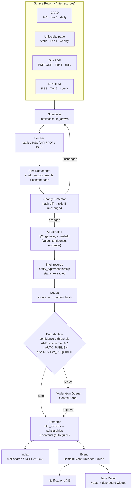

# JapaConnect Intelligence System — Design Spec

**Date:** 2026-08-12
**Status:** Approved (pending user spec review)
**Source idea:** `.jeos/ideas/japa-intelligence-system.md`
**Scope:** Ingestion spine + scholarships domain + Japa Radar (main site + dashboard widget + notifications). Flutter mobile Radar screen is v1.5 fast-follow; backend API endpoints are in v1.

---

## 1. Overview

JapaConnect already has the **consumer** half of an intelligence platform: scholarship finder (§73), remittance tracker (§74), destination wiki (§80), jobs board (§63), visa routes/timeline (§70/§83/§90/§93), cost of living (§72), embassy alerter (§91), AI core (§20), RAG knowledge layer (§69), notifications (§35), follow system (§31), content system (§14), Asynq workers (§11), Meilisearch (§13).

What does **not** exist is the **producer** half: a continuous pipeline that collects, verifies, normalizes, ranks, and publishes information from authoritative external sources into JapaConnect's knowledge layer.

This spec designs that producer half as a new `internal/intelligence/` package, proven end-to-end on the scholarships domain, with a user-facing Japa Radar surface. The spine is domain-agnostic; scholarships is the first projection. Future domains (jobs, visa, FX, remittance) reuse the spine via thin additions — each is its own later spec.

**Guiding principle (from source idea §2):** API first → official feeds second → structured scraping third → AI extraction/verification last.

### Decisions locked during brainstorming

| Decision | Choice |
|---|---|
| Scope | Ingestion spine + scholarships domain + Japa Radar (main + dashboard + notifications). Mobile Radar = v1.5 fast-follow; backend endpoints in v1. |
| Tenancy | Global platform-level data, geo-space-tagged, administered via Control Panel. Authoritative external sources (DAAD, Grants.gov) are not tenant-specific; geo space (§05) is the scoping dimension, not tenant. |
| Publish model | 1 record = 1 `contents` row (auto-generated guide, `canonical_url = source_url`) + 1 `scholarships` row referencing it. Dedup by source_url/external_key. UPDATE on re-crawl. |
| Fetcher v1 | Static HTTP + goquery, RSS, native API, PDF text extraction, OCR fallback. No Playwright (deferred to v2). |
| Spine architecture | Approach 1: generic `intel_records` (jsonb + confidence + evidence) as extraction output; thin domain projection tables (`scholarships`) with typed columns + indexes, populated by a per-domain promoter on publish; domain tables are writable for editorial overrides. Spine is domain-agnostic. |
| Naming | Surface = "Japa Radar" (`/radar` page, nav, notifications). Items are typed: "opportunity" for scholarships/jobs, "alert" for visa changes, "update" for FX/announcements. |
| Event bus | Asynq + Postgres in v1. Domain event emission goes through a `DomainEventPublisher` interface (Asynq-backed) so a future Kafka swap is bounded. Internal task orchestration stays Asynq permanently. Platform-wide Kafka is a separate future ADR. |
| Other domains | Out of v1. Each (jobs, visa, FX, remittance, cost-of-living…) gets its own later spec reusing this spine. |

---

## 2. Architecture

The Intelligence System is a new `internal/intelligence/` package producing a generic ingestion spine, with scholarships as the first domain projection and Japa Radar as the user-facing surface. It reuses the existing AI gateway (§20), Asynq workers (§11), Meilisearch (§13), RAG/pgvector (§69), notifications (§35), follow system (§31), and content system (§14). No new infrastructure — no Kafka, no separate vector DB, no separate crawler service.



### Key boundaries

- **`intel_sources` / `intel_raw_documents` / `intel_records`** are generic — domain-agnostic. The same three tables serve scholarships today and jobs/visa/FX tomorrow.
- **`scholarships`** is the only domain-specific table in v1. It's a thin projection with typed columns + indexes, populated by the promoter.
- **`contents`** row creation reuses §14 (content type `guide`, category `scholarship`) so SEO (§26), comments (§49), feed fan-out (§32), and RAG indexing (§69) come for free.
- **Crawl scheduling, fetching, raw storage, change detection, extraction, dedup, publish gate** are all generic services in `internal/intelligence/`. The only domain-specific logic is the **promoter** (maps `intel_records.extracted` jsonb → `scholarships` columns) and the **extraction schema** (the prompt + expected fields per entity_type).

### Package layout (idiomatic to JapaConnect)

```text
internal/intelligence/
├── sources/         # source registry CRUD + robots/rate-limit/license enforcement
├── fetcher/         # adapter framework: static, rss, api, pdf, ocr
│   └── testdata/    # fixture corpus for tests
├── extractor/       # AI extraction via §20 gateway, per-field confidence/evidence
│   └── schemas/     # per-entity-type field specs (scholarship.go in v1)
├── dedup/           # source_url + content-hash dedup
├── changedetector/  # raw-document hash diffing
├── promoter/        # intel_records → domain table projection (scholarships in v1)
├── scheduler/       # volatility-aware crawl scheduling
├── events/          # DomainEventPublisher interface + AsynqEventPublisher implementation
├── handlers/        # HTTP handlers (admin/control + public radar + webhooks)
├── services/        # business logic orchestration (publish gate, moderation actions)
└── stores/          # sqlc-generated DB access
```

---

## 3. Schema

Five new tables, all global (no `tenant_id` — geo-space is the scoping dimension per the tenancy decision). All use Postgres 18, uuid PKs, `timestamptz`, mirroring JapaConnect conventions.

### `intel_sources` — the Source Registry

```sql
CREATE TABLE intel_sources (
  id                   uuid PRIMARY KEY DEFAULT gen_random_uuid(),
  name                 text NOT NULL,
  domain               text NOT NULL,
  source_url           text NOT NULL,
  category             text NOT NULL,              -- 'scholarship'|'job'|'visa'|'fx'|'remittance'|'news'|'travel_alert'
  source_type          text NOT NULL,              -- 'government'|'embassy'|'university'|'immigration_authority'
                                                       -- 'central_bank'|'official_scholarship_provider'
                                                       -- 'international_org'|'financial_institution'|'educational_org'
                                                       -- 'scholarship_database'|'news'|'commercial'|'blog'
                                                       -- 'community'|'user_submission'
  trust_level          smallint NOT NULL,          -- 1=official ... 4=community
  crawl_method         text NOT NULL,              -- 'static'|'rss'|'api'|'pdf'|'ocr'
  crawl_frequency      text NOT NULL,              -- 'hourly'|'daily'|'weekly'|'monthly' (volatility bucket)
  crawl_frequency_mins int NOT NULL DEFAULT 1440,  -- resolved minutes, system_settings overridable
  robots_policy        jsonb NOT NULL DEFAULT '{}',-- {allowed: bool, crawl_delay_secs: int, disallowed_paths: []}
  source_license       text,                       -- 'CC-BY-4.0'|'public-domain'|'proprietary'|'unknown'
  attribution_required boolean NOT NULL DEFAULT true,
  usage_restriction    text,                       -- free-text ToS summary; fetcher refuses republish if 'proprietary'
  provider_config      jsonb NOT NULL DEFAULT '{}',-- per-provider API auth, endpoint path, response path (for crawl_method='api')
  enabled              boolean NOT NULL DEFAULT true,
  last_crawled_at      timestamptz,
  last_success_at      timestamptz,
  last_error_at        timestamptz,
  last_error_message   text,
  last_changed_at      timestamptz,                -- drives volatility auto-tuning
  consecutive_failures int NOT NULL DEFAULT 0,
  created_at           timestamptz NOT NULL DEFAULT now(),
  updated_at           timestamptz NOT NULL DEFAULT now()
);
CREATE UNIQUE INDEX idx_intel_sources_url ON intel_sources (source_url);
CREATE INDEX idx_intel_sources_enabled_freq ON intel_sources (enabled, crawl_frequency_mins) WHERE enabled;
CREATE INDEX idx_intel_sources_category ON intel_sources (category, trust_level);
```

### `intel_raw_documents` — raw source snapshots

```sql
CREATE TABLE intel_raw_documents (
  id            uuid PRIMARY KEY DEFAULT gen_random_uuid(),
  source_id     uuid NOT NULL REFERENCES intel_sources(id) ON DELETE CASCADE,
  url           text NOT NULL,
  http_status   int NOT NULL,
  http_headers  jsonb NOT NULL DEFAULT '{}',
  content_type  text,                              -- 'text/html'|'application/pdf'|'application/json'|'application/rss+xml'
  body          bytea NOT NULL,                    -- raw bytes: HTML, PDF, JSON, XML
  content_hash  text NOT NULL,                     -- sha256 of normalized body (for change detection)
  retrieved_at  timestamptz NOT NULL DEFAULT now()
);
CREATE INDEX idx_intel_raw_docs_source ON intel_raw_documents (source_id, retrieved_at DESC);
CREATE INDEX idx_intel_raw_docs_hash    ON intel_raw_documents (source_id, content_hash);
```

`body` is `bytea` not `text` because PDFs are binary. Change detection = `SELECT content_hash FROM intel_raw_documents WHERE source_id=$1 ORDER BY retrieved_at DESC LIMIT 1` and compare. Object storage is deferred — v1 keeps raw docs in Postgres; v2 can offload to S3-compatible storage with a `body_storage_ref` column when volume justifies it.

### `intel_records` — generic extraction output (the spine)

```sql
CREATE TABLE intel_records (
  id                  uuid PRIMARY KEY DEFAULT gen_random_uuid(),
  source_id           uuid NOT NULL REFERENCES intel_sources(id) ON DELETE CASCADE,
  raw_document_id     uuid NOT NULL REFERENCES intel_raw_documents(id) ON DELETE CASCADE,
  entity_type         text NOT NULL,               -- 'scholarship' (v1); 'job'|'visa'|'fx'... (later specs)
  external_key        text NOT NULL,               -- source_url OR source-specific stable id; dedup key
  extracted           jsonb NOT NULL,              -- raw AI extraction: full field set, snake_case keys
  confidence          jsonb NOT NULL,              -- per-field confidence: {field_name: 0.0-1.0}
  evidence            jsonb NOT NULL,              -- per-field evidence: {field_name: "source snippet"}
  confidence_overall  real NOT NULL,               -- aggregate confidence score
  status              text NOT NULL DEFAULT 'extracted'
                        CHECK (status IN ('extracted','deduped','auto_published','review_required','approved','rejected','published','stale')),
  freshness_score     int NOT NULL DEFAULT 100,    -- 100=today,90=this week,70=this month,40=older,0=stale
  geo_space_ids       uuid[] NOT NULL DEFAULT '{}',-- space_ids this record is relevant to
  extracted_at        timestamptz NOT NULL DEFAULT now(),
  last_verified_at    timestamptz NOT NULL DEFAULT now(),
  promoted_record_id  uuid,                        -- set to scholarships.id (or jobs.id later) once promoted
  UNIQUE(source_id, external_key)
);
CREATE INDEX idx_intel_records_entity_status ON intel_records (entity_type, status);
CREATE INDEX idx_intel_records_geo           ON intel_records USING gin (geo_space_ids);
CREATE INDEX idx_intel_records_promoted      ON intel_records (promoted_record_id) WHERE promoted_record_id IS NOT NULL;
```

`external_key` is the dedup key. For most scholarship sources, it's the canonicalized source_url. The dedup step (`intel:dedup` task) checks `(source_id, external_key)` uniqueness — if a record already exists with the same key, this is an UPDATE path, not a new record.

### `scholarships` — domain projection (§73 amendment)

```sql
CREATE TABLE scholarships (
  id                    uuid PRIMARY KEY DEFAULT gen_random_uuid(),
  intel_record_id       uuid REFERENCES intel_records(id) ON DELETE CASCADE,  -- nullable: backfilled rows from §73 predate ingestion
  guide_id              uuid NOT NULL REFERENCES contents(id) ON DELETE CASCADE,
  source_url            text NOT NULL,
  source_type           text NOT NULL,
  trust_level           smallint NOT NULL,
  title                 text NOT NULL,
  description           text,                       -- AI-summarized body excerpt; full body lives in contents
  country               text NOT NULL,              -- ISO-3 country code
  country_space_id      uuid REFERENCES spaces(id), -- resolved geo space; nullable if no space yet
  university            text,
  degree_level          text,                       -- 'bachelors'|'masters'|'phd'|'postdoc'|'diploma'|'certificate'
  fields_of_study       text[] NOT NULL DEFAULT '{}',
  eligible_countries    text[] NOT NULL DEFAULT '{}', -- ISO-3 codes
  funding               jsonb NOT NULL DEFAULT '{}',  -- {tuition: bool, living_allowance: bool, travel: bool, accommodation: bool, amount_usd: numeric|null}
  deadline              date,
  application_url       text,
  required_documents    text[] NOT NULL DEFAULT '{}',
  minimum_gpa           numeric(3,2),
  language_requirements jsonb NOT NULL DEFAULT '{}', -- {ielts: 7.0|null, toefl: 100|null, ...}
  confidence_overall    real NOT NULL,
  verification_status   text NOT NULL DEFAULT 'verified'
                          CHECK (verification_status IN ('verified','needs_review','conflict','stale')),
  freshness_score       int NOT NULL DEFAULT 100,
  override_source       text NOT NULL DEFAULT 'ingestion'
                          CHECK (override_source IN ('ingestion','editorial','mixed')),
  editorial_overrides   jsonb NOT NULL DEFAULT '{}', -- {field_name: overridden_value} for fields an admin edited
  last_verified_at      timestamptz NOT NULL DEFAULT now(),
  created_at            timestamptz NOT NULL DEFAULT now(),
  updated_at            timestamptz NOT NULL DEFAULT now()
);
CREATE UNIQUE INDEX idx_scholarships_intel      ON scholarships (intel_record_id) WHERE intel_record_id IS NOT NULL;
CREATE UNIQUE INDEX idx_scholarships_guide      ON scholarships (guide_id);
CREATE INDEX idx_scholarships_country_deadline  ON scholarships (country, deadline);
CREATE INDEX idx_scholarships_eligible          ON scholarships USING gin (eligible_countries);
CREATE INDEX idx_scholarships_fields            ON scholarships USING gin (fields_of_study);
CREATE INDEX idx_scholarships_status_fresh      ON scholarships (verification_status, freshness_score);
CREATE INDEX idx_scholarships_space             ON scholarships (country_space_id);
```

**Editorial override mechanics:** when an admin edits a field via the moderation surface, the new value goes into `editorial_overrides`, `override_source` flips to `'mixed'` (or `'editorial'` if all fields are overridden), and on the next crawl the promoter **skips fields present in `editorial_overrides`** — the human edit wins. This is the clean way to handle "AI extracted the wrong deadline, admin fixed it, don't let the crawler revert it."

**`intel_record_id` is nullable** to support the §73 backfill migration — existing scholarship guide content (in `custom_field_values`) gets promoted to `scholarships` rows without an `intel_records` parent (they predate the ingestion system). `override_source='editorial'` for backfilled rows (treat existing data as human-curated).

**§73 amendment:** §73 currently says "no parallel data store" — scholarships live in `custom_field_values`. This design introduces a dedicated `scholarships` table. That reverses §73's locked decision and **requires ADR-XXX** (filed alongside this spec in `.jeos/adr/`). `saved_scholarships.guide_id` continues to work unchanged — it references `contents(id)` either way. Existing scholarship guide content remains valid; the migration backfills `scholarships` rows from existing `custom_field_values` (one-time data migration, reversible via down migration). The §73 section file is updated to reference the new `scholarships` table.

### `intel_review_log` — moderation audit trail

```sql
CREATE TABLE intel_review_log (
  id              uuid PRIMARY KEY DEFAULT gen_random_uuid(),
  intel_record_id uuid NOT NULL REFERENCES intel_records(id) ON DELETE CASCADE,
  actor_user_id   uuid NOT NULL REFERENCES users(id),
  action          text NOT NULL,                   -- 'approve'|'reject'|'edit'|'override'|'republish'|'auto_update'|'conflict_detected'
  field_changes   jsonb NOT NULL DEFAULT '{}',     -- {field: {from, to}}
  note            text,
  created_at      timestamptz NOT NULL DEFAULT now()
);
CREATE INDEX idx_intel_review_log_record ON intel_review_log (intel_record_id, created_at DESC);
```

### Relationships

```text
intel_sources ─┬─< intel_raw_documents ─< intel_records ─┬─< scholarships ─> contents
               │                                            │
               │                                            └─< intel_review_log
               │
               └─ (admin-managed via Control Panel, RBAC-gated)
```

---

## 4. Crawl & Fetcher Pipeline

The pipeline is a chain of Asynq tasks (per §11 catalog discipline — all new tasks added to the catalog first). Each stage emits the next; failures route to the DLQ with exponential backoff.

### Task chain

```text
intel:schedule_crawls (critical, every 15 min, cron)
    │ selects intel_sources WHERE enabled AND now() - last_crawled_at >= crawl_frequency_mins
    ▼
intel:fetch_source (default)        ← per-source, idempotent via SET NX EX lock
    │ fetcher adapter runs (static|rss|api|pdf|ocr)
    │ stores intel_raw_documents row
    ▼
intel:detect_changes (default)      ← compares new content_hash vs latest prior for source_id
    │ UNCHANGED → update intel_sources.last_crawled_at, done.
    │ CHANGED   → intel:extract (continue chain)
    ▼
intel:extract (default)             ← AI extraction via §20 gateway
    │ produces intel_records row, status='extracted'
    ▼
intel:dedup (default)               ← (source_id, external_key) uniqueness check
    │ NEW       → status='deduped', proceed to gate
    │ EXISTING  → diff extracted fields vs prior, UPDATE if changed, skip if identical
    ▼
intel:publish_gate (default)        ← confidence + trust_level → AUTO_PUBLISH or REVIEW_REQUIRED
    │ AUTO_PUBLISH    → intel:promote
    │ REVIEW_REQUIRED → status='review_required', stop chain, surface in Control Panel
    ▼
intel:promote (default)             ← promoter maps intel_records → scholarships + contents
    │ creates contents row (guide/scholarship) + scholarships row
    │ OR updates existing scholarships row if re-crawl with changes (respecting editorial_overrides)
    ▼
intel:post_publish (default)        ← Meilisearch index + RAG embedding + emit domain event
    │ enqueues content:index_search (existing §13 task)
    │ enqueues content:generate_embedding (existing §69 task)
    │ calls DomainEventPublisher.Publish (see §6)
```

### Fetcher adapter framework (`internal/intelligence/fetcher/`)

A single `Fetcher` interface with five implementations. The scheduler selects the adapter by `intel_sources.crawl_method`.

```go
type Fetcher interface {
    Fetch(ctx context.Context, source intel.Source) (FetchResult, error)
}

type FetchResult struct {
    HTTPStatus  int
    Headers     map[string]string
    ContentType string
    Body        []byte                  // raw bytes (HTML, PDF, JSON, XML)
    ContentHash string                  // sha256 of normalized body
}
```

**Adapter selection by `crawl_method`:**

- `static` → `StaticFetcher`: `net/http` + `goquery` for HTML parsing. Normalizes body (strips scripts/styles, collapses whitespace) before hashing.
- `rss` → `RSSFetcher`: parses RSS/Atom, expands each item into its own fetch (each item URL becomes a per-item `intel_raw_documents` row + `intel:fetch_source` re-enqueue for the item's full page).
- `api` → `APIFetcher`: per-provider native Go client. v1 ships two: Grants.gov (json) and a generic JSON HTTP client for sources with stable endpoints. Each API source has `provider_config jsonb` on `intel_sources` (provider-specific auth, endpoint path, response path).
- `pdf` → `PDFFetcher`: downloads PDF, runs text extraction (`github.com/ledongthuc/pdf` — pure Go, no external deps). If extracted text length < N chars or returns empty, fall back to OCR.
- `ocr` → `OCRFetcher`: invokes `tesseract` via `os/exec` (external binary; `apt-get install tesseract-ocr tesseract-ocr-eng`). Renders PDF pages to images via `pdftoppm` if needed. Only triggered as fallback from `PDFFetcher`. Cache OCR output in Valkey (`jc:intel:ocr_cache:{content_hash}`) to avoid re-OCRing.

**Pre-flight enforcement** (in `Fetch()` base, before any adapter runs):

1. **robots.txt** — fetch and cache `/robots.txt` per source domain (Valkey cache `jc:intel:robots:{domain}`, 1h TTL). Refuse to crawl disallowed paths. Store parsed policy in `intel_sources.robots_policy`.
2. **Rate limit** — Valkey token-bucket per domain: `jc:intel:ratelimit:{domain}` key, refill rate from `intel_sources.crawl_frequency_mins` divided down (default 10/min from `intel.ratelimit_default_per_min`). Block-fetch if no token.
3. **License check** — if `source_license = 'proprietary'` AND `usage_restriction` indicates no-republish, refuse to store body (abort extraction chain). For Tier 3+ sources, `source_license` must be non-NULL or the fetcher refuses republish.
4. **Crawl lock** — `SET NX EX jc:intel:crawllock:{source_id} 3600` prevents concurrent crawls of the same source. Key expires after 1h to recover from crashed workers.

### Change detection (`internal/intelligence/changedetector/`)

After a new `intel_raw_documents` row is written:

```sql
SELECT content_hash FROM intel_raw_documents
WHERE source_id = $1 AND id <> $2
ORDER BY retrieved_at DESC LIMIT 1;
```

- **No prior** → CHANGED (first crawl).
- **Same hash** → UNCHANGED. Update `intel_sources.last_crawled_at = now()`. Done.
- **Different hash** → CHANGED. Proceed to `intel:extract`. Update `intel_sources.last_changed_at = now()`.

Per-field change detection (the source idea's §11: "deadline: 15 Sept → 30 Sept") happens at the **promoter** step, after extraction, by comparing the new `intel_records.extracted` against the prior promoted `scholarships` row. Field-level diffs are recorded in `intel_review_log` automatically on update (`action='auto_update'`).

### Scheduler volatility logic (`internal/intelligence/scheduler/`)

`intel:schedule_crawls` runs every 15 min (cron), selects due sources:

```sql
SELECT * FROM intel_sources
WHERE enabled = true
  AND (last_crawled_at IS NULL OR now() - last_crawled_at >= (crawl_frequency_mins || ' minutes')::interval)
ORDER BY last_crawled_at NULLS FIRST
LIMIT 50;  -- per-tick cap, system_settings 'intel.schedule_batch_size'
```

Volatility auto-tuning (the source idea's §9): a source's `crawl_frequency_mins` starts at its configured default. After 5 consecutive unchanged crawls, the scheduler **doubles** the effective interval (caps at weekly). After a change, **halves** it back toward the configured default. The effective interval is stored in `jc:intel:effective_interval:{source_id}` (Valkey, 7d TTL — no DB column churn). `intel_sources.last_changed_at` drives this.

---

## 5. AI Extraction & Confidence

The core differentiator. The source idea's §5 is unambiguous: **the AI must not hallucinate missing values**. A `null` with `confidence: 0.99` and `evidence: null` is correct; a hallucinated `3.5` is not. The extraction design enforces this structurally, not by prompt alone.

### Extraction contract (`internal/intelligence/extractor/`)

The extractor calls the §20 AI gateway (already wired: multi-provider, circuit-breaker, RBAC-gated). The LLM is given the raw document text + an **entity schema** describing the expected fields with types, and is instructed to return JSON with a strict per-field shape:

```json
{
  "title":             {"value": "DAAD EPOS Scholarship 2027", "confidence": 0.97, "evidence": "...excerpt..."},
  "deadline":          {"value": "2027-10-15",                "confidence": 0.95, "evidence": "...excerpt..."},
  "minimum_gpa":       {"value": null,                       "confidence": 0.99, "evidence": null},
  "eligible_countries":[{"value": ["NGA","GHA","LBR"],        "confidence": 0.88, "evidence": "...excerpt..."},
  "funding":           {"value": {"tuition": true, "living_allowance": true, "travel": false, "accommodation": false, "amount_usd": null}, "confidence": 0.82, "evidence": "...excerpt..."}
}
```

Every field is a `{value, confidence, evidence}` triple. `evidence` is the verbatim snippet the LLM extracted from (cited back to the admin in the moderation surface). `value: null` with high confidence means "the source does not mention this field" — explicitly different from "low confidence extraction."

### Per-entity-type schemas (`internal/intelligence/extractor/schemas/`)

Each `entity_type` has a schema file declaring expected fields, types, and validation rules:

```go
type FieldSpec struct {
    Name       string
    Type       string  // "string"|"date"|"text_array"|"country_array"|"jsonb_object"|"numeric"
    Required   bool
    EnumValues []string // for degree_level etc.
}

type EntitySchema struct {
    EntityType string
    Fields     []FieldSpec
}
```

v1 ships one schema: `scholarship`. Fields match the `scholarships` table columns (title, deadline, country, university, degree_level, fields_of_study, eligible_countries, funding, application_url, required_documents, minimum_gpa, language_requirements). New domains later = new schema files, no extractor code change.

### Prompt construction (per extraction run)

```text
SYSTEM:
You are an extraction engine for JapaConnect's intelligence platform.
Extract structured fields from the source document below.
For every field, return {value, confidence, evidence}.

RULES:
1. value MUST be null if the source does not explicitly state the field.
   Never infer, guess, or fill from prior knowledge.
2. confidence ∈ [0,1] reflects how certain you are the value is correct AND
   completely stated by the source.
3. evidence MUST be a verbatim quote from the source supporting value.
   evidence MUST be null when value is null.
4. Dates MUST be ISO-8601 (YYYY-MM-DD).
5. Countries MUST be ISO-3 codes.
6. Return ONLY the JSON object matching the schema. No prose.

ENTITY SCHEMA: {fields with types}

SOURCE METADATA:
  source_url: ...
  source_type: ...
  retrieved_at: ...

SOURCE TEXT:
  {raw document text, truncated to model context window}
```

The prompt is built from a template per entity_type so domain-specific rules (e.g. "for scholarships, `eligible_countries` means countries whose nationals may apply, not the destination country") live alongside the schema.

### Post-extraction validation (`internal/intelligence/extractor/validate.go`)

Before writing `intel_records`, the extractor runs deterministic validation on the LLM output:

1. **Schema match** — every field in the entity schema is present; no extra fields.
2. **Type coercion** — `date` parses to `time.Time`, `country_array` validates ISO-3 codes against the `spaces` table (country spaces), `numeric` parses, `enum` fields are in the allowed set.
3. **Confidence sanity** — `confidence ∈ [0,1]`. If a field has `value: null`, `evidence` MUST be null (and vice versa) — violations are hard rejects.
4. **Evidence presence for non-null values** — any non-null `value` MUST have non-empty `evidence`. An LLM claiming `minimum_gpa: 3.5` with no evidence is treated as a hallucination → field is reset to `{value: null, confidence: 0, evidence: null}` and the run is flagged for review.
5. **Retry on malformed JSON** — up to 2 retries with a "your previous response was malformed: {error}" preamble. After 3 malformed attempts (`intel.extraction_max_retries`), the run fails → `intel_records.status = 'extracted'` but `confidence_overall = 0` and it routes to `REVIEW_REQUIRED`.

If validation passes, the extractor writes the row:

```sql
INSERT INTO intel_records (source_id, raw_document_id, entity_type, external_key, extracted, confidence, evidence, confidence_overall, status, geo_space_ids)
VALUES ($1, $2, 'scholarship', $3, $4, $5, $6, $7, 'extracted', $8);
```

`confidence_overall` = weighted mean of per-field confidence (weights per field in the schema — `title`/`deadline`/`country` weighted higher than `minimum_gpa`). `geo_space_ids` is resolved by mapping the extracted `country` (destination) + `eligible_countries` (origins) to `spaces` rows of `level='country'`.

### Confidence thresholds (system_settings, hot-reloadable per §3)

| Key | Default | Purpose |
|-----|---------|---------|
| `intel.extraction_confidence_auto` | `0.85` | Records ≥ this AND source Tier 1-2 → AUTO_PUBLISH |
| `intel.extraction_confidence_review` | `0.50` | Records ≥ this but below auto → REVIEW_REQUIRED |
| `intel.extraction_confidence_reject` | `0.50` | Records below this → flagged for re-extraction or rejection |
| `intel.extraction_max_retries` | `3` | Malformed-JSON retries |
| `intel.extraction_model` | `gpt-4o-mini` | Model via §20 gateway (cost-tuned; switchable) |

### Conflict detection (source idea §21)

When `intel:dedup` finds an existing record with the same `external_key` from a **different** `intel_sources.id` (e.g. DAAD page + university page describing the same scholarship), it does NOT merge — it records a conflict:

- A new `intel_records` row is created with `status = 'review_required'`.
- The `intel_review_log` gets an automatic entry: `action='conflict_detected'`, `field_changes` = the diff between the two extractions.
- The Control Panel surfaces these in a "Conflicts" queue. An admin picks the canonical extraction (or merges fields) → promotes.

v1 does NOT do AI-driven semantic dedup across different source URLs. v1 dedup is strictly `external_key`-based. Semantic merge is a v2 concern — it's hard, error-prone, and YAGNI for the first domain.

### Provenance & freshness (source idea §6, §20)

`intel_records` already carries `source_id`, `extracted_at`, `last_verified_at`, `freshness_score`. The freshness scorer is a deterministic cron task:

```text
intel:refresh_freshness (default, daily cron)
  for each intel_records row:
    age_days = now() - last_verified_at
    freshness_score = case
      when age_days <= 1  → 100
      when age_days <= 7  → 90
      when age_days <= 30 → 70
      when age_days <= 90 → 40
      else                → 0
    end
    if freshness_score <= 40 → status='stale', re-enqueue intel:fetch_source for the source
```

Per-entity-type freshness policy is a system_setting: `intel.freshness_decay_scholarship` etc. Scholarships decay slowly (deadlines don't move weekly); FX rates would decay fast (future domain).

### What this section rules out (deliberately)

- **No autonomous AI-driven crawling** (source idea §16 — fully endorsed). The LLM only sees documents the deterministic scheduler fetched.
- **No semantic cross-source dedup in v1.** Strict `external_key` only.
- **No fine-tuning a JapaConnect model.** The source idea's §25 is explicit — keep rapidly-changing data in the knowledge layer, retrieve via RAG/tools. The extractor uses the §20 gateway with a switchable model. The stable "JapaConnect reasoning" the idea mentions is future work, out of v1 scope.

---

## 6. Promotion, Publish Gate, Moderation & Event Emission

Where the generic spine meets the scholarships domain, and where humans enter the loop.

### Promoter (`internal/intelligence/promoter/`)

The promoter is the **only domain-specific step** in the otherwise generic spine. It maps `intel_records.extracted` (jsonb) → `scholarships` (typed columns) + creates/updates the `contents` row.

```go
type Promoter interface {
    Promote(ctx context.Context, rec intel.Record) (PromoteResult, error)
    Entity() string // "scholarship"
}

type PromoteResult struct {
    ScholarshipID  uuid.UUID
    ContentID      uuid.UUID
    Action         string // "created" | "updated"
    ChangedFields  []string
}
```

#### Create path (first time this `external_key` is published)

1. Insert `contents` row — type `guide`, category `scholarship`, `status='published'`, `canonical_url = rec.source_url`, `title = rec.extracted.title.value`, `body` = AI-summarized description generated via §20 gateway (one extra LLM call: "summarize this scholarship in 2-3 paragraphs for prospective applicants" given the extracted fields + raw text). Body stored as TipTap JSON per §15. `content_hash` computed per Rule 12.
2. Insert `scholarships` row — `guide_id` = the new content's id, `intel_record_id` = rec.id, all typed columns from `rec.extracted`, `confidence_overall` from rec, `verification_status='verified'`, `override_source='ingestion'`, `editorial_overrides='{}'`.
3. Set `intel_records.promoted_record_id = scholarships.id`, `status='published'`.
4. Emit `intel:post_publish` (next task in chain).

#### Update path (re-crawl with changes, existing `external_key`)

1. Load existing `scholarships` row by `intel_record_id` (or by `source_url` if the intel_record was re-created).
2. Compute field-level diff: for each field in `rec.extracted`, compare against the existing `scholarships` column value.
3. **For fields present in `editorial_overrides`**: skip — the human edit wins. Do not overwrite.
4. **For fields not in `editorial_overrides`**: apply the new value. Record the change in `intel_review_log` automatically: `action='auto_update'`, `field_changes={field: {from, to}}`.
5. Update `scholarships.updated_at`, `last_verified_at = now()`, `freshness_score = 100`.
6. Update the `contents` row's title/body only if `title` or `description` changed and neither is in `editorial_overrides`. Re-compute `content_hash`.
7. `PromoteResult.Action = 'updated'`, `ChangedFields = [...]`. Emit `intel:post_publish`.

If the diff is empty (re-crawl produced identical extraction), skip the writes entirely — just bump `last_verified_at` and `freshness_score`.

#### Field mapping table (extractor → scholarships)

| `extracted` jsonb key | `scholarships` column |
|---|---|
| `title` | `title` |
| `description_summary` | `description` |
| `country` | `country` (ISO-3) |
| `university` | `university` |
| `degree_level` | `degree_level` |
| `fields_of_study` | `fields_of_study` (text[]) |
| `eligible_countries` | `eligible_countries` (text[]) |
| `funding` | `funding` (jsonb) |
| `deadline` | `deadline` (date) |
| `application_url` | `application_url` |
| `required_documents` | `required_documents` (text[]) |
| `minimum_gpa` | `minimum_gpa` (numeric) |
| `language_requirements` | `language_requirements` (jsonb) |

### Publish gate (`internal/intelligence/services/gate.go`)

The `intel:publish_gate` task is a pure function — no DB writes, just routing:

```go
func classify(rec intel.Record, source intel.Source, settings config.Settings) GateDecision {
    autoThreshold := settings.GetFloat("intel.extraction_confidence_auto", 0.85)
    reviewThreshold := settings.GetFloat("intel.extraction_confidence_review", 0.50)

    switch {
    case rec.ConfidenceOverall >= autoThreshold && source.TrustLevel <= 2:
        return AutoPublish           // → intel:promote
    case rec.ConfidenceOverall >= reviewThreshold:
        return ReviewRequired        // → status='review_required', stop chain
    case source.TrustLevel >= 3 && rec.ConfidenceOverall < reviewThreshold:
        return Reject                // → status='rejected', log, stop
    default:
        return ReviewRequired        // conservative default
    }
}
```

**The rule, in plain terms:** a record auto-publishes only if (a) overall confidence ≥ 0.85 **AND** (b) the source is Tier 1 or 2 (official/trusted). Anything from Tier 3-4 (aggregators, community, user submissions) goes to review regardless of confidence. Anything below 0.50 confidence goes to review or rejection.

### Event emission seam (`internal/intelligence/events/`)

Domain events flow through a `DomainEventPublisher` interface. v1 ships the Asynq-backed implementation; a future Kafka-backed implementation can swap in at this one seam without touching intelligence business logic. **Internal task orchestration** (the `intel:fetch_source` → `intel:extract` → `intel:promote` chain) is NOT abstracted — it stays Asynq permanently, because it is task dispatch with explicit dependencies, not event streaming.

```go
// DomainEventPublisher emits intelligence domain events. Asynq-backed in v1;
// a Kafka-backed implementation can swap in without touching business logic.
type DomainEventPublisher interface {
    Publish(ctx context.Context, evt DomainEvent) error
}

type DomainEvent struct {
    Type        string          // "scholarship.published" | "scholarship.deadline_changed" | ...
    EntityType  string          // "scholarship"
    EntityID    uuid.UUID
    Payload     json.RawMessage
    OccurredAt  time.Time
}

// AsynqEventPublisher is the v1 implementation. It enqueues the
// intel:notify_discoveries task (which fans out to §35 notifications)
// and any other downstream Asynq tasks triggered by the event.
type AsynqEventPublisher struct {
    client *asynq.Client
    // ...
}
```

`intel:post_publish` calls `publisher.Publish(ctx, evt)` instead of enqueuing Asynq tasks directly at the event-emission seam. The `AsynqEventPublisher` implementation enqueues `intel:notify_discoveries` as before. A future `KafkaEventPublisher` writes to a Kafka topic. **Business logic is identical in both cases** — the swap is one constructor injection in `cmd/api` DI.

**Why this is not YAGNI:** the interface is natural (event emission is a real boundary, not a contrived abstraction), the cost is near-zero (one interface, one struct, one method), and the alternative — calling Asynq directly at every emit site — creates real migration debt for a platform-wide Kafka adoption.

### Moderation surface (Control Panel — `apps/control`)

The Control Panel (§21) gets a new "Data Intelligence" section with six queues, matching the source idea's §22:

```text
DATA INTELLIGENCE
├── Sources         — intel_sources CRUD, enable/disable, crawl-now button, last-crawl status
├── Crawls          — recent intel_raw_documents, success/failure counts, retry-failed button
├── New Data        — intel_records by entity_type, status='extracted'|'deduped', "needs review" filter
├── Needs Review    — intel_records.status='review_required' — the moderation queue
├── Conflicts       — intel_records flagged by conflict detection (same external_key, diff source)
└── Stale Data      — intel_records.freshness_score <= 40, sources with consecutive failures
```

**The review workflow** (source idea §22: "Source → Raw content → AI extraction → Evidence → Structured record → Approve/Reject/Edit"):

For a single `intel_records` row in the review queue, the Control Panel renders a four-pane view:

1. **Source pane** — `intel_sources` metadata (name, domain, trust tier, license, last crawled).
2. **Raw content pane** — the `intel_raw_documents.body` rendered (HTML rendered, PDF via embedded viewer, JSON pretty-printed). Read-only.
3. **Extraction pane** — every extracted field as `{value, confidence, evidence}`. Each field shows: the value, the confidence bar (green ≥0.85, yellow 0.50-0.85, red <0.50), and the evidence snippet with a "jump to source" link that scrolls the raw pane to the evidence text. Editable inline.
4. **Structured record pane** — a preview of the `scholarships` row that would be created on approval. Live-updates as the admin edits fields in pane 3.

Admin actions (all RBAC-gated, all logged to `intel_review_log`):

| Action | Effect |
|---|---|
| **Approve** | `status='approved'` → enqueues `intel:promote`. No field edits → publishes as-extracted. |
| **Approve with edits** | Admin edits fields in pane 3 → edited values stored to `editorial_overrides` on the resulting `scholarships` row, `override_source='editorial'` → enqueues `intel:promote`. |
| **Reject** | `status='rejected'`, logged with `note`. Record is not promoted. Source remains enabled. |
| **Disable source** | Sets `intel_sources.enabled=false`. Stops future crawls. Existing promoted records stay. |
| **Edit published** | On an already-published scholarship, admin edits a field → goes to `editorial_overrides`, `override_source='mixed'`, next crawl respects the override. |

### RBAC permissions (new nodes — added to §03 catalog)

```text
intel.sources.manage         — CRUD on intel_sources (control panel)
intel.sources.crawl_now      — trigger immediate crawl of a source
intel.review.view            — view review queue + raw documents + extractions
intel.review.approve         — approve records, publish
intel.review.reject          — reject records
intel.review.edit            — edit fields (writes to editorial_overrides)
intel.review.disable_source  — disable a source
intel.radar.view             — view Japa Radar (any authenticated user by default; gate per user group)
```

All assigned to the `platform_admin` user group by default. `intel.radar.view` assigned to all authenticated users.

### Asynq tasks added to §11 catalog

```text
intel:schedule_crawls     — critical, cron every 15 min, due-source selection
intel:fetch_source        — default, per-source fetch + raw doc storage
intel:detect_changes      — default, content-hash diff
intel:extract             — default, AI extraction via §20 gateway
intel:dedup               — default, external_key uniqueness + conflict flag
intel:publish_gate        — default, confidence/trust routing (no DB write)
intel:promote             — default, intel_records → scholarships + contents
intel:post_publish        — default, Meilisearch + RAG + event emit via DomainEventPublisher
intel:notify_discoveries  — default, fan-out notifications (§35)
intel:refresh_freshness   — default, daily cron, freshness decay + stale re-crawl
intel:retry_failed_source — default, manual trigger from control panel
```

11 new tasks. All `namespace:action` format, all in the §11 catalog before any code uses them (Rule 7).

### system_settings (added to catalog)

| Key | Default | Description |
|-----|---------|---------|
| `intel.enabled` | `true` | Global intelligence system toggle |
| `intel.schedule_batch_size` | `50` | Max sources selected per scheduler tick |
| `intel.extraction_confidence_auto` | `0.85` | Auto-publish threshold |
| `intel.extraction_confidence_review` | `0.50` | Review threshold |
| `intel.extraction_confidence_reject` | `0.50` | Reject threshold |
| `intel.extraction_max_retries` | `3` | Malformed JSON retries |
| `intel.extraction_model` | `gpt-4o-mini` | Extraction model via §20 gateway |
| `intel.freshness_decay_scholarship` | `slow` | Freshness policy: slow/medium/fast |
| `intel.crawl_lock_ttl_secs` | `3600` | Crawl lock TTL |
| `intel.ratelimit_default_per_min` | `10` | Default rate-limit tokens per domain per min |

10 new keys (Rule 3 — no hardcoded values; added to `system-settings-catalog.md`).

### Valkey keys (added to catalog)

| Pattern | Purpose | TTL |
|---------|---------|-----|
| `jc:intel:ratelimit:{domain}` | Token bucket for domain rate limiting | sliding |
| `jc:intel:crawllock:{source_id}` | Prevent concurrent crawls of same source | 3600s |
| `jc:intel:effective_interval:{source_id}` | Volatility-adjusted crawl interval | 7d |
| `jc:intel:robots:{domain}` | Cached robots.txt policy | 1h |
| `jc:intel:ocr_cache:{content_hash}` | OCR output cache (avoid re-OCRing) | 30d |
| `jc:intel:extraction_cache:{content_hash}` | Identical-source extraction result cache | 24h |

6 new key patterns (Rule 4 — added to `valkey-keys-catalog.md`).

---

## 7. Japa Radar Surface & Notifications

The user-facing half. Three surfaces in v1 (main site, dashboard widget, notifications) plus backend API endpoints that serve all clients including the v1.5 Flutter screen.

### API endpoints (new routes — added to §api-routes-catalog)

All under `/api/v1/intel/`, all geo-scoped via the user's `current_geo_space_id` (or explicit `space_id` query param for browsing other countries). No `tenant_id` scoping — global platform data per the tenancy decision.

```text
GET  /api/v1/intel/radar                    — radar feed for the user
  ?space_id=uuid        (optional; defaults to user's current_geo_space_id, or global if none)
  ?item_type=scholarship|job|visa_alert|fx_update|announcement  (optional filter)
  ?since=timestamptz    (optional; for incremental "what's new" polling)
  ?cursor=...           (keyset pagination)
  ?limit=int            (default 20, max 50)
  Returns: { items: [RadarItem], next_cursor, has_more, counts_by_type, counts_by_country }

GET  /api/v1/intel/radar/counts             — lightweight counts for dashboard widget + notification badges
  ?space_id=uuid
  Returns: { total_new, by_type: {scholarship: N, job: N, ...}, by_country: {CAN: N, DEU: N, ...} }

GET  /api/v1/intel/radar/followed           — radar feed filtered to user's followed spaces only
  (same params as /radar; uses §31 follow system — user follows country spaces)

POST /api/v1/intel/radar/follow             — follow a country space for radar (delegates to §31)
  body: { space_id: uuid }
  (alias of §31 follow endpoint, scoped to country-level spaces; included for UX cohesion)

DELETE /api/v1/intel/radar/follow           — unfollow
  body: { space_id: uuid }

GET  /api/v1/intel/radar/feed/{item_id}     — single radar item detail (scholarship detail reuses §73 routes)
  Returns: RadarItem with full detail + source provenance summary

GET  /api/v1/intel/radar/saved              — user's saved opportunities (reuses §73 saved_scholarships + future saved_jobs)
  ?status=saved|researching|applied|accepted|rejected|withdrawn
  Returns: [SavedItem]

POST /api/v1/intel/radar/save               — save an opportunity (delegates to §73 saved_scholarships)
  body: { item_id: uuid, item_type: string }

DELETE /api/v1/intel/radar/save/{item_id}   — unsave

GET  /api/v1/intel/scholarships             — filtered scholarship search (the §73 finder, backed by scholarships table)
  ?country=ISO3&eligible_country=ISO3&degree_level=...&deadline_after=date&deadline_before=date
  ?fields_of_study=csv&funding_tuition=true&min_confidence=float
  ?q=text  (full-text via Meilisearch §13)
  ?cursor=...&limit=int
  Returns: { items: [Scholarship], next_cursor, has_more, facets }

GET  /api/v1/intel/scholarships/{id}        — scholarship detail (full scholarships row + contents body + provenance)

GET  /api/v1/intel/sources                  — public source directory (trust-tier display, for transparency)
  ?category=scholarship&trust_level=1|2
  Returns: [SourceSummary]  (name, domain, trust_level, category, last_verified_at — no crawl internals)
```

12 routes. All named consistently in `api-routes-catalog.md` before code (cross-surface contract).

### RadarItem shape (the unified feed object)

```typescript
interface RadarItem {
  id: string;                  // scholarships.id (or future jobs.id / visa_alerts.id)
  item_type: 'scholarship' | 'job' | 'visa_alert' | 'fx_update' | 'announcement';
  title: string;
  summary: string;             // one-line, derived from scholarships.description
  country: string;             // ISO-3
  country_space_id: string;
  trust_level: 1 | 2 | 3 | 4;
  verification_status: 'verified' | 'needs_review' | 'conflict' | 'stale';
  freshness_score: number;     // 0-100
  published_at: string;        // ISO timestamp (scholarships.created_at or updated_at)
  url: string;                 // deep link to /radar/feed/{id} on main site
  source: { name: string; domain: string; source_url: string; trust_level: number };
  // type-specific payload:
  scholarship?: ScholarshipSummary;  // deadline, degree_level, funding_summary, eligible_countries
  // job?: JobSummary;               // future
  // visa_alert?: VisaAlertSummary;  // future
}
```

v1 only populates `item_type='scholarship'` + the `scholarship` payload. The shape is forward-compatible — adding jobs/visa later means populating another optional payload field, not changing the API contract.

### Main site `/radar` page (`apps/main`)

New SSR route at `apps/main/src/routes/radar/+page.server.ts` (port 3000). Reuses the unified app shell (ADR-058). Layout:

```text
┌─────────────────────────────────────────────────────────┐
│  Japa Radar                                              │
│  Continuously scanning official sources for scholarships,│
│  visa updates, jobs, and alerts relevant to your         │
│  destinations.                                           │
├──────────────┬──────────────────────────────────────────┤
│  Filters     │  ┌── Canada 🇨🇦 ──────────────── 23 new ┐  │
│              │  │  ▸ Scholarships (18)                  │  │
│  Followed:   │  │    • DAAD EPOS Scholarship 2027       │  │
│  🇨🇦 Canada ✓│  │      Masters · Deadline Oct 15        │  │
│  🇩🇪 Germany✓│  │      Verified · Tier 1 · 2d ago       │  │
│  🇯🇵 Japan ✓ │  │    • ...                               │  │
│              │  │  ▸ Jobs (5)                            │  │
│  Browse:     │  └────────────────────────────────────────┘  │
│  🇬🇧 UK      │  ┌── Germany 🇩🇪 ─────────────── 11 new ┐  │
│  🇺🇸 USA     │  │  ...                                   │  │
│  🇦🇺 Australia│ └────────────────────────────────────────┘  │
│              │                                             │
│  Type:       │  [Load more]                                │
│  □ Scholarship│                                            │
│  □ Job       │                                             │
│  □ Visa alert│                                             │
└──────────────┴─────────────────────────────────────────────┘
```

- **SSR** for first paint (SEO + fast first load), then SvelteKit `invalidate` on follow/unfollow mutations.
- **Country grouping** — items grouped by `country_space_id`, sorted by `counts_by_country` desc, then `published_at` desc within group.
- **Follow button per country** — delegates to §31 follow system (follow the country space). Followed countries pinned to top, unfollowed browse list below.
- **Item rows** — title, type-specific summary (deadline + degree for scholarships), trust tier badge, freshness indicator, "verified" vs "needs review" pill, deep-link to `/radar/feed/{id}`.
- **No hardcoded data** (Rule 16) — all data from `/api/v1/intel/radar` + `/api/v1/intel/radar/followed` in `+page.server.ts load()`. Country list from `/api/v1/spaces?level=country` (existing route).
- **Pagination** — keyset cursor, "Load more" button (not infinite scroll — SSR-friendly, no hydration jank).

### Dashboard widget (`apps/main` user dashboard)

A compact Radar card on the user dashboard showing "X new opportunities in your followed countries". Reuses §59 sidebars / dashboard pattern. Calls `/api/v1/intel/radar/counts` (lightweight). Click-through to `/radar`. Shows last 3 items as a teaser with deep-links. No new page — just a widget component in the existing dashboard.

### Notifications (§35 integration)

When `intel:post_publish` runs for a new scholarship (Action='created') or a significant update (Action='updated' with `deadline` in ChangedFields), the `AsynqEventPublisher` enqueues `intel:notify_discoveries`:

1. Find users who follow the country space(s) in `scholarships.country_space_id` (via §31 follow table).
2. Batch-insert notifications (§35 `notification:dispatch_batch` — existing critical-tier task) with type `intel_radar_new` or `intel_radar_deadline_changed`.

Notification payload:

```json
{
  "type": "intel_radar_new",
  "title": "New scholarship in Canada",
  "body": "DAAD EPOS Scholarship 2027 — Masters, deadline Oct 15. Verified from official source.",
  "deep_link": "/radar/feed/{item_id}",
  "metadata": { "item_type": "scholarship", "country": "CAN", "trust_level": 1 }
}
```

**Respects §35 batch windows** (per recent migration d4e0c757 — `notification batch windows tenant_id`). Notifications are batched per user per window, not one-push-per-scholarship. A user following 5 countries where 30 scholarships publish overnight gets one batched digest, not 30 pushes.

**Deadline-approaching reminders** reuse the existing §73 daily deadline-check task — it already checks `saved_scholarships` and sends reminders. No new task needed; it now reads from the `scholarships` table instead of `custom_field_values`. **Implementation note:** verify the exact §73 deadline-check task name against the §11 Asynq catalog during implementation (the §11 catalog is the source of truth for task names per Rule 7); this spec does not invent a new task name for this purpose.

### v1.5 Flutter mobile (out of v1 spec, endpoints ready)

The `/api/v1/intel/radar*` endpoints are JSON, auth via existing §02 session/JWT, and serve any client. The Flutter Radar screen (apps/mobile, §77) is a fast-follow consuming the same endpoints + push via §35 mobile push channel. **No backend work in v1.5** — just the mobile UI. This keeps v1 backend-complete while letting mobile ship when ready.

### Rule 16 compliance

- `/radar` page load() calls the API. ✓
- Country list from `/api/v1/spaces?level=country`. ✓
- Follow/unfollow delegates to §31 API. ✓
- Dashboard widget calls `/api/v1/intel/radar/counts`. ✓
- No hardcoded country/scholarship arrays anywhere. ✓
- All mutations via POST/DELETE to API, then `invalidate`. ✓

---

## 8. Reusability, Testing & Operational Concerns

### Reusability — adding a new domain (e.g. jobs in v2)

The spine's whole justification is "build once, extend cheaply." Adding a domain is a **thin addition**, not a parallel system:

| What changes for a new domain | Where |
|---|---|
| New `entity_type` value ('job') | Constant — no schema change to `intel_records` |
| New entity schema file (`internal/intelligence/extractor/schemas/job.go`) | Declares the job field set + types |
| New extraction prompt template | Domain-specific extraction rules |
| New domain table (`jobs_intel` or reuse existing `internal/jobs` §63) | Typed columns + indexes |
| New promoter (`internal/intelligence/promoter/job.go`) | Maps `intel_records.extracted` → `jobs` table |
| New RBAC nodes if domain has unique admin actions | Usually none — generic `intel.review.*` covers it |
| New Radar `item_type` | Populate the optional `job` payload in `RadarItem` |
| New system_settings for domain-specific thresholds | e.g. `intel.extraction_confidence_auto_job` |

**What does NOT change:** `intel_sources`, `intel_raw_documents`, `intel_records`, the fetcher framework, the scheduler, the change detector, the dedup logic, the publish gate, the moderation surface (it already filters by `entity_type`), the Asynq task chain, the post-publish indexing/event emission, the Radar API contract (forward-compatible `RadarItem`), the `DomainEventPublisher` interface.

Concretely, the estimated diff to add jobs in v2: ~3 new files (schema, promoter, prompt template) + 1 migration (the `jobs` projection table) + catalog entries (entity_type, system_settings). The ingestion spine code is untouched. That's the test of whether the boundary is right.

### Testing strategy

Following JapaConnect's testing conventions (§27) + TDD discipline where it adds value.

**Unit tests** (per-package, table-driven, Go standard):

| Package | What to test | Approach |
|---|---|---|
| `fetcher/` | Each adapter parses its fixture correctly; normalization produces stable hashes; robots.txt refusal; rate-limit refusal; license refusal | Fixture files in `testdata/` (sample HTML, RSS, PDF, JSON); assert `FetchResult.ContentHash` is stable across runs |
| `extractor/` | Schema validation catches hallucination cases; confidence/evidence pairing enforced; type coercion (date, ISO-3, enum); malformed-JSON retry | **Critical:** test cases where LLM returns `minimum_gpa: 3.5` with empty evidence → must be reset to null + flagged. Mock the §20 gateway with a fixed response. |
| `changedetector/` | Hash-equal → UNCHANGED; hash-diff → CHANGED; first-crawl → CHANGED | Pure function tests, no DB |
| `dedup/` | Same `external_key` + same `source_id` → UPDATE; same `external_key` + different `source_id` → conflict flag | Test DB (JapaConnect's `internal/testdb` pattern) |
| `promoter/` | Create path produces correct `scholarships` + `contents` rows; update path respects `editorial_overrides` (the human-wins invariant); empty-diff skips writes | Test DB; the editorial-override test is the most important — it prevents the crawler-reverts-human-edit regression |
| `gate/` | Confidence × trust-tier matrix: all 4 quadrants + edge cases (exactly 0.85, Tier 2 boundary) | Pure function tests |
| `scheduler/` | Due-source selection; volatility doubling/halving logic | Mock clock |
| `freshness/` | Decay buckets (1d/7d/30d/90d); stale re-crawl enqueue | Mock clock |
| `events/` | `AsynqEventPublisher` enqueues correct task with correct payload | Mock Asynq client |

**Integration tests** (test DB, full task chain):

- `intel_test.go` — end-to-end: insert a fixture `intel_sources` row → run `intel:fetch_source` → `intel:detect_changes` → `intel:extract` (mocked gateway) → `intel:dedup` → `intel:publish_gate` → `intel:promote` → assert `scholarships` + `contents` rows exist with correct values.
- `intel_update_test.go` — re-crawl with changed fixture → assert `scholarships` row updated, `intel_review_log` has `auto_update` entry, `editorial_overrides` respected.
- `intel_ocr_test.go` — PDF with embedded text → text extraction succeeds, OCR not invoked. Scanned PDF (no text) → OCR fallback invoked (requires tesseract in CI; skip with `testing.Short()` if absent).
- `intel_conflict_test.go` — two sources, same `external_key` → second creates `review_required` record + conflict log entry.

**Fixture corpus** (`internal/intelligence/testdata/`):
- `scholarship_daad.html` — real DAAD page snapshot, static
- `scholarship_rss.xml` — RSS feed with 3 scholarship items
- `scholarship_grantsgov.json` — Grants.gov API response
- `scholarship_gov_pdf.pdf` — government PDF announcement (with embedded text)
- `scholarship_scanned.pdf` — image-only PDF (for OCR path)
- `scholarship_html_js_only.html` — a JS-rendered page (v1 fetcher should extract minimal/no text → record flagged for review, since Playwright is deferred)

**Frontend tests** (apps/main, per §27 + Playwright config already in repo):
- `/radar` page renders country-grouped feed from API mock; follow button toggles via §31; "Load more" paginates; SSR produces correct HTML (no hydration mismatch — per jc-main-debug skill).
- Dashboard widget renders counts from `/radar/counts`; click-through navigates to `/radar`.
- Control Panel moderation queue renders the four-pane view; approve/reject/edit actions call correct endpoints.

**Acceptance criteria** (Rule 15 — phase not complete until verified):
- All `intel:*` Asynq tasks registered in §11 catalog and present in `internal/worker` Asynq server at startup (no unregistered task silently dropped).
- All 13 `/api/v1/intel/*` routes return non-404 under correct auth (audit script).
- `gosec` reports zero HIGH/CRITICAL findings in `internal/intelligence/`.
- Control Panel "Data Intelligence" section renders all 6 queues with real data.
- `/radar` page loads with zero hardcoded data (Rule 16 audit).
- `intel_sources` CRUD works end-to-end from Control Panel.

### Operational concerns

**External dependencies added:**
- `github.com/ledongthuc/pdf` — pure-Go PDF text extraction. No system dependency.
- `tesseract-ocr` — system binary for OCR fallback. Installed via `apt-get install tesseract-ocr tesseract-ocr-eng`. Added to `Dockerfile` and documented in `docs/00-foundation/`. CI image includes it. OCR path is graceful-degradation — if `tesseract` is absent, `OCRFetcher` logs and the record routes to `REVIEW_REQUIRED` (not a hard failure).
- `github.com/PuerkitoBio/goquery` — static HTML parsing (likely already in `go.sum`; verify during implementation).
- `pdftoppm` (poppler-utils) — only needed to render PDF pages to images for OCR when `tesseract` consumes image input. Installed via `apt-get install poppler-utils`. Same graceful-degradation posture as tesseract.

**Cost controls:**
- AI extraction is the cost center. `intel.extraction_model` defaults to `gpt-4o-mini` (cheap) — switchable via system_settings without code change (Rule 3). Per-extraction cost logged to `ai_usage_log` (§20).
- `jc:intel:extraction_cache:{content_hash}` (24h TTL) — if the same source is fetched twice within 24h with identical content (e.g. scheduler tick overlap), the cached extraction is reused, skipping the LLM call.
- `intel.schedule_batch_size=50` caps per-tick concurrency.
- Volatility auto-tuning reduces crawl frequency for stable sources, directly cutting fetch + extraction cost.

**Failure modes & recovery:**

| Failure | Behavior |
|---|---|
| Source returns 4xx/5xx | `intel_sources.last_error_at` + `consecutive_failures++`; after 5 consecutive (configurable), auto-disable source + alert control panel |
| Source HTML structure changes | Extractor returns low confidence → routes to REVIEW_REQUIRED (graceful, not a crash) |
| LLM returns malformed JSON | 3 retries; on final failure, `status='extracted'`, `confidence_overall=0` → REVIEW_REQUIRED |
| LLM hallucinates (value without evidence) | Validation catches it → field reset to null + flagged; if many fields flagged → REVIEW_REQUIRED |
| Tesseract/pdftoppm missing | OCR path logs + routes record to REVIEW_REQUIRED; non-fatal |
| Asynq DLQ entry | Per §11 — exponential backoff; control panel "Retry failed" button enqueues `intel:retry_failed_source` |
| Crawl lock stuck (worker crash mid-crawl) | `SET NX EX` TTL expires after 1h → next scheduler tick re-enqueues |
| Postgres raw_documents bloat | v1 keeps in DB; monitor `intel_raw_documents` size in control panel; v2 offloads to S3 + `body_storage_ref` |

**Legal/compliance posture (source idea §24):**
- `intel_sources.source_license` + `attribution_required` + `usage_restriction` are mandatory fields. `source_license` nullable but fetcher refuses republish if NULL for Tier 3+ sources.
- Attribution: every published `contents` row from ingestion includes a "Source: {source name} ({source_url})" line in the body footer. `canonical_url` set to `source_url` per §26 SEO.
- GDPR (§19): `intel_sources`/`intel_raw_documents`/`intel_records` contain no PII (they're public-source data). `intel_review_log.actor_user_id` is the only user reference — included in GDPR erasure job (extend §19 erasure task to delete `intel_review_log` rows for the erased user).
- Robots.txt compliance is enforced pre-flight, not optional.

**Monitoring (Control Panel dashboard):**
- Sources: total / active / failing / disabled
- Crawls: success rate (24h/7d), avg latency, DLQ depth
- Extraction: avg confidence, records/hr, LLM cost (from `ai_usage_log`)
- Queue: needs review / conflicts / stale counts
- Storage: `intel_raw_documents` row count + total size

---

## 9. Migration, Rollout & Out-of-Scope

### Migration plan

Follows the `jc-backend-migrate` skill discipline: up/down pairing, zero-downtime, circular-FK-safe ordering, sqlc regeneration after.

**Migration 428 (up) — `intel_sources` + `intel_raw_documents` + `intel_records` + `intel_review_log`:**
The four generic spine tables. No FKs to existing JapaConnect tables (no `contents`, `spaces`, `users` references except `intel_review_log.actor_user_id → users(id)`). Creates indexes. Safe to ship and run independently — no data, no consumers yet.

**Migration 429 (up) — `scholarships` table + §73 amendment:**
Creates `scholarships` with `guide_id → contents(id)` and `country_space_id → spaces(id)` FKs. The `country_space_id` FK is added via ALTER TABLE after table creation (spaces already exists, so no circular-FK issue). Also adds the FK from `intel_records.promoted_record_id → scholarships(id)` via ALTER TABLE — this couldn't be in migration 428 because `scholarships` didn't exist yet (circular FK resolved by deferred ALTER, per Rule 13 pattern). Adds the GIN/btree indexes.

**Migration 430 (up) — backfill `scholarships` from existing `custom_field_values`:**
One-time data migration. For each existing `contents` row in the `scholarship` guide category, reads its `custom_field_values` and creates a corresponding `scholarships` row. No `intel_records` row is created for backfilled data (they predate the ingestion system) — `scholarships.intel_record_id` is nullable for this reason. `override_source='editorial'` for backfilled rows (treat existing data as human-curated). `source_url` populated from `canonical_url` where available, else `contents.id`-derived placeholder. This is the migration that reverses §73's "no parallel data store" decision in practice.

**Migration 431 (up) — RBAC nodes + system_settings seeds:**
Inserts the 8 new RBAC permission nodes (`intel.sources.manage`, `intel.sources.crawl_now`, `intel.review.view`, `intel.review.approve`, `intel.review.reject`, `intel.review.edit`, `intel.review.disable_source`, `intel.radar.view`) into the permission tree (§03). Assigns defaults: `intel.radar.view` → all authenticated users; `intel.sources.*` + `intel.review.*` → `platform_admin` group. Seeds the 10 `system_settings` keys with defaults. Idempotent (uses `ON CONFLICT DO NOTHING`).

**Down migrations 428d–431d:** reverse order. 431d removes RBAC nodes + settings (only the new ones, by name). 430d is a no-op (backfilled `scholarships` rows are not deleted — they're real data now; the down migration just marks the backfill as reversible by leaving the rows in place and dropping the `scholarships` table in 429d). 429d drops `scholarships` + indexes. 428d drops the four spine tables.

**sqlc regeneration:** after migrations 428–430 land, run `make sqlc-gen` (Rule 2) to generate the typed query structs for the new tables. Query files added to `db/queries/intelligence.sql` + `db/queries/scholarships_intel.sql`.

**§73 ADR amendment (filed alongside spec):** ADR-XXX — "Dedicated `scholarships` table for intelligence system projection." Reverses §73's "no parallel data store" locked decision. Justification: machine-extracted provenance/confidence/evidence data is a different shape from editorial content metadata; the `custom_field_values` EAV store cannot carry per-field confidence or evidence. The `contents` row remains the editorial wrapper (title, body, SEO, comments, RAG) — `scholarships` is the structured projection. `saved_scholarships.guide_id → contents(id)` continues to work unchanged. The ADR is written in JEOS (`.jeos/adr/`) before any code, per the "JEOS is always updated before code" rule.

### Rollout sequence (gated, reversible at each step)

1. **Migrations 428–431 + sqlc gen + spine code (no routes, no scheduler cron enabled).** Ship behind `intel.enabled=false`. No crawls run. No routes exposed. Control Panel "Data Intelligence" section visible only to `platform_admin`. Verify: tables exist, RBAC nodes seeded, sqlc compiles, no route 404s yet (routes not wired).
2. **Seed 3–5 Tier-1 scholarship sources manually via Control Panel** (DAAD, Grants.gov API, 2-3 university pages). `intel.enabled=true` but `intel.schedule_batch_size=5`. First crawl runs manually (crawl-now button). Verify: raw docs fetched, extractions land in review queue, four-pane moderation works, approve → `scholarships` + `contents` rows created, `/api/v1/intel/scholarships` returns them.
3. **Enable `/radar` page + dashboard widget + notifications.** Verify: `/radar` renders country-grouped feed, follow/unfollow works, notifications batch correctly, dashboard widget shows counts.
4. **Enable scheduler cron** (`intel:schedule_crawls` registered in Asynq server). Volatility auto-tuning kicks in after a few cycles. Monitor cost + queue depth for 1 week.
5. **Expand source list** — admin adds more sources via Control Panel. Each new source is a config change, not a code change (source idea §17 goal).

Each step is independently revertable: disable `intel.enabled` to stop all crawls without touching promoted data; disable the cron to pause scheduling; remove the `/radar` route to hide the surface without dropping data.

### Out of v1 scope

| Out | Why | When |
|---|---|---|
| Jobs, visa, FX, remittance, cost-of-living ingestion domains | Prove the spine on scholarships first; each is its own spec | v2+ specs, each reusing this spine |
| Playwright / Chromium JS-rendered scraping | Heavy ops; most authoritative sources are static | v2, if JS-rendered sources prove necessary |
| Semantic cross-source dedup / multi-source merge | Hard, error-prone, YAGNI for first domain | v2, when source overlap becomes common |
| Fine-tuning a "JapaConnect AI model" | Source idea §25 explicitly defers — keep fresh data in knowledge layer, retrieve via RAG | Future, separate spec |
| Object storage (S3) for raw documents | v1 volume fits in Postgres | v2, when `intel_raw_documents` size justifies offload |
| Kafka / NATS event bus | Not v1. Domain event emission goes through `DomainEventPublisher` interface (Asynq-backed); a future `KafkaEventPublisher` swaps in at one seam without touching intelligence business logic. Platform-wide Kafka adoption is a separate ADR, triggered when: event volume crosses ~10K/sec sustained, platform moves to microservices, event replay becomes a real need, or multiple external subscribers want a JapaConnect event stream. Internal task orchestration (crawl→extract→promote chain) stays Asynq permanently — it's task dispatch, not event streaming. Note (Level 2 / campground rule): as other subsystems (§35 notifications, §32 feeds, §12 webhooks) are touched for unrelated reasons, introduce an `EventPublisher` interface at their emit seams so the platform migrates incrementally rather than via big-bang refactor. | Separate future ADR |
| Flutter mobile Radar screen | Separate app codebase; backend endpoints are ready in v1 | v1.5 fast-follow, mobile UI only |
| AI-driven crawler autonomy (LLM decides what to crawl) | Source idea §16 explicitly forbids; deterministic scheduler only | Not planned |
| Real-time push (WebSocket) for Radar updates | §10 WebSocket exists but Radar is poll/notify-based via §35 | Future, if user demand justifies |
| User-submitted sources (Tier 4) | Moderation burden; v1 is official/trusted sources only | v2, with a submission + review flow |
| Country knowledge graph (source idea §8 full vision) | Existing `wiki` (§80) + `spaces` (§05) cover the structure; intelligence system enriches them over time | Incremental, not a v1 deliverable |

### Risk register

| Risk | Mitigation |
|---|---|
| Source HTML changes break extraction | Graceful: low confidence → REVIEW_REQUIRED, not a crash. Admin edits + `editorial_overrides` bridge until source is reconfigured. |
| LLM cost exceeds budget | `gpt-4o-mini` default + extraction cache + volatility-tuned crawl frequency + per-domain `system_settings` thresholds. Monitor `ai_usage_log`. |
| Tesseract/pdftoppm ops burden in CI/prod | Graceful degradation — missing binary → REVIEW_REQUIRED, not failure. CI installs it; prod Dockerfile documents it. |
| Legal challenge from a source | `source_license` + `usage_restriction` + `attribution_required` enforced pre-flight. Attribution in every published content. Disable-source button for immediate takedown. |
| §73 reversal introduces inconsistency | ADR-XXX filed before code. `saved_scholarships` unchanged. Backfill migration preserves existing data. §73 section file updated to reference the new `scholarships` table. |
| Raw document bloat in Postgres | Monitor in Control Panel. v2 offload to S3 is a documented future step, not a v1 blocker. |

---

## Cross-reference summary

| JapaConnect section reused | How |
|---|---|
| §02 Authentication | Radar API auth, control panel auth |
| §03 RBAC | 8 new permission nodes |
| §04 Multi-tenancy | N/A — global platform data per tenancy decision |
| §05 Geo-first space system | `country_space_id` resolution, geo-scoped Radar |
| §11 Asynq | 11 new tasks in catalog |
| §12 Webhooks | Future external event subscribers (out of v1) |
| §13 Search (Meilisearch) | `content:index_search` for published scholarships |
| §14 Content type system | Auto-generated `guide`/`scholarship` `contents` rows |
| §15 Block editor (TipTap) | AI-summarized body as TipTap JSON |
| §19 GDPR | `intel_review_log.actor_user_id` in erasure job |
| §20 AI core | Multi-provider gateway for extraction + summarization |
| §21 Control panel | "Data Intelligence" section + moderation surface |
| §26 SEO | `canonical_url = source_url` on published content |
| §27 DevOps/testing | Test strategy, fixture corpus, acceptance criteria |
| §31 Follow system | Radar country follow |
| §32 Activity feed | Fan-out of published scholarship content |
| §35 Notifications | `intel:notify_discoveries` → `notification:dispatch_batch` |
| §49 Comments | Scholarship content is commentable |
| §69 RAG knowledge layer | `content:generate_embedding` for published scholarships |
| §73 Scholarship finder | Reversed by ADR-XXX; `saved_scholarships` unchanged |
| §77 Flutter mobile | v1.5 fast-follow consuming v1 endpoints |
| §80 Destination wiki | Country intelligence enriches wiki over time (incremental) |
| ADR-058 App shell | `/radar` page reuses unified shell |
| ADR-088 Geo-aware tool | Geo-space scoping aligns with this pattern |

---

## Open items for implementation plan

The writing-plans skill will produce the implementation plan. Items the plan must address (non-exhaustive):

- Migration files 428–431 (up + down) + sqlc gen
- ADR-XXX written in `.jeos/adr/` before any code
- §11 catalog update (11 new tasks)
- §03 RBAC catalog update (8 new nodes)
- `system-settings-catalog.md` update (10 new keys)
- `valkey-keys-catalog.md` update (6 new patterns)
- `api-routes-catalog.md` update (12 new routes)
- §73 section file update (reference new `scholarships` table)
- `internal/intelligence/` package scaffold (11 sub-packages)
- Fetcher adapters: static, rss, api, pdf, ocr
- Extractor + scholarship schema + prompt template
- Promoter (scholarship) + create/update paths
- Publish gate
- `DomainEventPublisher` interface + `AsynqEventPublisher`
- Scheduler + volatility auto-tuning
- Change detector + dedup
- Freshness scorer
- Handlers (12 routes) + handlers wiring in `internal/server/server.go`
- Asynq task handlers (11) + registration in worker
- Control Panel "Data Intelligence" section (6 queues + four-pane moderation)
- Main site `/radar` page (SSR) + dashboard widget
- Notifications integration (§35 batch windows)
- Test suite (unit + integration + fixtures + frontend)
- Dockerfile update (tesseract, poppler-utils)
- `docs/00-foundation/` update (ops deps)
- Rollout gating per the 5-step sequence
