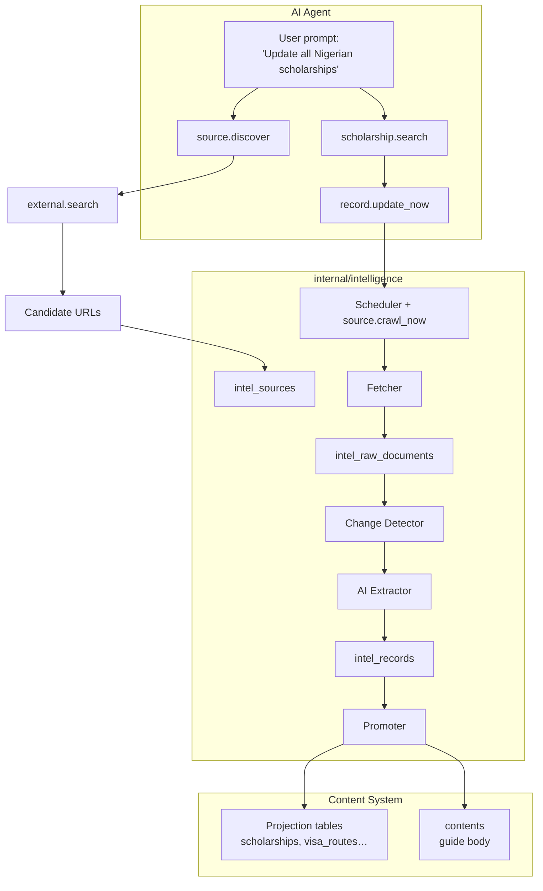

# On-Demand AI Source Discovery and Content Refresh for JapaConnect Intelligence

**Date:** 2026-08-19  
**Status:** Draft — pending user review  
**Source idea:** Continuation of `docs/superpowers/specs/2026-08-12-japa-intelligence-system-design.md` (ADR-112, ADR-076 Amendment 1)  
**Scope:** Add an AI agent control plane on top of the existing `internal/intelligence` spine. The agent can discover new sources, force immediate updates of existing structured content, and regenerate the narrative `contents` body alongside the projection row. Background scheduling and source registry remain intact.

---

## 1. Overview

JapaConnect's intelligence pipeline already fetches, hashes, extracts, and promotes external sources into structured projection tables (`scholarships`, `visa_routes`, `housing_guides`, etc.). What it does not do today is:

1. Allow a user or agent to request an immediate update of a specific cohort of records from natural language.
2. Discover brand-new source URLs from the web and add them to the source registry.
3. Regenerate the associated `contents` guide body when the underlying structured data changes.

This spec designs an **agent-triggered, intelligence-backed** on-demand layer that reuses the existing source registry, scheduler, fetcher, extractor, and promoters, while adding new AI tools and a content-regeneration worker.

### Decisions locked during brainstorming

| Decision | Choice |
|---|---|
| Keep or remove `internal/intelligence`? | **Keep**. Source registry, scheduler, change detection, extractor, and promoters remain the source of truth for freshness, provenance, and attribution. |
| Direct agent write vs. agent-triggered pipeline? | **Agent-triggered pipeline**. The AI calls tools that enqueue the existing worker chain; the pipeline writes to tables. Direct table writes by the agent are out of scope for now. |
| Structured data + content generation? | **Both in one pass**. The promoter updates the projection row and also generates/updates the linked `contents` guide body. |
| Source discovery auto-enable? | **No**. New sources start in `proposed` status with `enabled=false`; admin review is required. Optional tenant setting `agent.auto_enable_discovered_sources` can bypass review for trusted domains and high-confidence sources. |
| Content HITL for high-stakes types? | **Yes**. High-stakes categories and tool-table types require human review unless `studio.auto_publish_types` is explicitly configured. |
| Web search seam for source discovery? | **Reuse `external.search`** (Tavily/Brave/Perplexity) already present in the AI tool catalog. |

---

## 2. Architecture



### Key boundaries

- The **intelligence spine** (`internal/intelligence`) remains unchanged in scope: it owns source registry, scheduling, fetching, change detection, extraction, and promotion.
- The **AI agent** is a new control plane: it can search structured records, trigger immediate crawls, discover sources, and request content regeneration.
- The **promoter** is the only intelligence component that changes: it gains the ability to generate or update the linked `contents` guide body, not just the projection row.
- The **AI gateway** and **Studio generation pipeline** are reused for body generation; no new LLM orchestration is introduced.

---

## 3. New AI Agent Tools

All tools are registered in `internal/ai/tools_register.go` (or a new `internal/ai/tools_intelligence.go`) and gated by RBAC.

| Tool | Input | Output | Behavior |
|---|---|---|---|
| `scholarship.search` | `country`, `eligible_countries`, `deadline_after`, `funding_type`, `limit` | List of scholarship records with `id`, `intel_record_id`, `source_id`, `content_id` | Queries the `scholarships` projection table. Parallel tools for `job.search`, `visa.search`, `housing.search`, etc. are added per domain as needed. |
| `record.update_now` | `intel_record_id` or `source_id` | Batch/job ID | Enqueues `intel:fetch_source` for the source, then the normal `detect_changes → extract → promote` chain runs. Respects source crawl locks and rate limits. |
| `source.crawl_now` | `source_id` | Job ID | Enqueues `intel:fetch_source` for a single source. Lower-level version of `record.update_now`. |
| `source.discover` | `query`, `category`, `country`, `limit` | List of proposed source objects | Calls `external.search`, lets the LLM evaluate candidate URLs, and creates `intel_sources` rows with `status=proposed` and `enabled=false`. |
| `content.regenerate_from_source` | `content_id`, `intel_record_id` | Job ID | Enqueues the new `content:regenerate_from_source` worker to rewrite the body from the latest extraction. |
| `source.propose` / `source.approve` (admin) | `source_id` | Status | Control Panel / admin tools to review and enable proposed sources. |

### Tool registration references

- `external.search` is already implemented in `internal/ai/tools_knowledge.go` and supports Tavily, Brave, and Perplexity.
- `content.create`, `content.update`, `content.read` are already registered in `internal/ai/tools_register.go`.

---

## 4. Promoter Enhancement: Dual Structured + Content Update

Currently, most domain promoters (e.g., `ScholarshipPromoter`, `VisaPromoter`, `HousingPromoter`) write only the projection row and return `ContentID=uuid.Nil`, relying on Studio auto-promote to generate a guide later. `GuideContentPromoter` writes a `contents` row but stores a JSON dump of the extraction, not a narrative article, and its update path is a stub.

### New behavior

On every `Promote` call (create or update):

1. **Update the projection row** with extracted structured fields, respecting `editorial_overrides`.
2. **Generate or update the linked `contents` guide body** from the extraction, using the same AI gateway call that Studio uses for draft generation:
   - Load the source's persona (`intel_sources.persona_id`) or fall back to `studio.default_persona_id`.
   - Load the content type schema for the target `content_type` and `guide_category`.
   - Call the AI gateway with the extraction JSON as grounding context.
   - Write the generated body to the `contents` row (create on first promote, update on re-crawl).
3. **Respect HITL / auto-publish gates**: for high-stakes categories or tool-table content types, the generated content is created with `status=draft` and routed to HITL review. For low-stakes or explicitly allowed types, it can be published immediately based on `studio.auto_publish_types`.
4. **Log an `auto_update` review log** entry when fields or the body change.

### Editorial override for body

If a human has manually edited the `contents` body, the promoter must not overwrite it silently. Detection can use:

- `contents.ai_generated_at` timestamp vs `contents.updated_at`/`contents.manual_body_edited_at`.
- Or a flag `contents.body_editorial_override` set by the content system when a non-persona user saves the body.

If the body is overridden, the promoter may skip regeneration or route to HITL.

---

## 5. Content Regeneration Worker

A new Asynq task type `content:regenerate_from_source` is introduced.

**Payload:**
```json
{
  "tenant_id": "...",
  "content_id": "...",
  "intel_record_id": "..."
}
```

**Handler steps:**

1. Load `contents` row and `intel_records` row.
2. Load the linked `intel_source` and persona.
3. Resolve content type and guide category from the content row.
4. Call the AI gateway with the extraction as grounding (reuse `studioGenerateBody` or equivalent).
5. Update `contents.body` and `contents.ai_generated_at`/`ai_model`.
6. Create or update HITL review if required.
7. Log `auto_update`.

This worker is enqueued by:
- the promoter when the projection row is updated and a linked `content_id` exists;
- the `content.regenerate_from_source` agent tool on demand.

---

## 6. Source Discovery Workflow

### Agent flow

1. User: "Find new scholarship sources for Nigerians."
2. Agent calls `source.discover` with `query="scholarships for Nigerian students 2025"`, `category="scholarship"`, `country="NGA"`.
3. `source.discover` calls `external.search` to get candidate URLs.
4. The LLM evaluates candidates for relevance, authority, and duplication against existing `intel_sources`.
5. For each selected candidate, the tool inserts a new `intel_sources` row:
   - `status = 'proposed'`
   - `enabled = false`
   - `trust_level = 3` (Aggregator) or `4` (Community) by default
   - `crawl_method = 'static'` (default; admin can change)
   - `crawl_frequency = 'weekly'` (default)
   - attribution/license fields left empty for admin review

### Admin review

- A new Control Panel section lists proposed sources.
- Admin can approve (enable + queue first crawl), reject, or edit the source metadata.
- Approved sources transition to `status='active'`, `enabled=true`, and are picked up by the scheduler.

### Optional auto-enable

A tenant setting `agent.auto_enable_discovered_sources` controls whether proposed sources from trusted domains or high-confidence evaluations can skip admin review and be enabled immediately. Default is `false`.

---

## 7. Example Data Flows

### 7.1 "Update all Nigerian scholarships"

1. User prompts agent.
2. Agent: `scholarship.search` with `country = 'NGA'`.
3. Agent receives list of scholarships with `source_id` and `intel_record_id`.
4. Agent deduplicates by `source_id` and calls `source.crawl_now` per unique source.
5. Worker chain runs: `fetch_source → detect_changes → extract → promote`.
6. Promoter updates `scholarships` row and regenerates `contents` body.
7. High-stakes content (e.g., `scholarship` guide) goes to HITL unless auto-publish is enabled.
8. Agent returns a batch tracking ID.

### 7.2 "Find new scholarship sources for Nigerians"

1. User prompts agent.
2. Agent: `source.discover` with query and category.
3. `source.discover` calls `external.search`.
4. Candidate URLs are filtered and inserted as `proposed` sources.
5. Agent returns a list of proposed source URLs and IDs.
6. Admin reviews and enables them, or `agent.auto_enable_discovered_sources` auto-enables trusted ones.

---

## 8. RBAC and Permissions

New permission nodes (seeded via migration):

| Permission | Description |
|---|---|
| `agent.source.discover` | Use `source.discover` to find new sources. |
| `agent.source.crawl_now` | Trigger immediate crawl via `source.crawl_now`. |
| `agent.scholarship.search` | Query the scholarships projection table. |
| `agent.record.update_now` | Force an immediate record update. |
| `content.regenerate` | Trigger `content.regenerate_from_source`. |
| `intel.sources.propose` | Create proposed sources (agent). |
| `intel.sources.approve` | Approve/reject proposed sources (admin). |

Existing `intel.sources.manage`, `intel.sources.crawl_now`, `intel.review.*` are reused where applicable.

---

## 9. System Settings

New settings (seeded via migration):

| Key | Type | Default | Description |
|---|---|---|---|
| `agent.source_discovery.enabled` | bool | `false` | Master switch for `source.discover`. |
| `agent.auto_enable_discovered_sources` | bool | `false` | Auto-enable proposed sources from trusted domains or high-confidence evaluations. |
| `agent.discovery_trust_level_default` | int | `3` | Default trust level for discovered sources (3 = Aggregator). |
| `agent.discovery_default_crawl_method` | string | `'static'` | Default crawl method for proposed sources. |
| `agent.max_discovered_sources_per_query` | int | `5` | Max sources inserted per `source.discover` call. |
| `agent.regenerate_content_on_promote` | bool | `false` | Whether the promoter should auto-regenerate the linked `contents` body on update. |
| `content.regeneration_hitl_for_high_stakes` | bool | `true` | Force HITL review for regenerated high-stakes content. |

---

## 10. Schema Changes

### `intel_sources`

Add:

```sql
ALTER TABLE intel_sources
  ADD COLUMN status text NOT NULL DEFAULT 'active',
  ADD COLUMN proposed_by uuid REFERENCES users(id),
  ADD COLUMN proposed_at timestamptz,
  ADD COLUMN reviewed_by uuid REFERENCES users(id),
  ADD COLUMN reviewed_at timestamptz,
  ADD COLUMN review_note text;
```

`status` values: `active`, `proposed`, `rejected`, `disabled`.

### `contents`

Add (or reuse if already present):

```sql
ALTER TABLE contents
  ADD COLUMN ai_generated_at timestamptz,
  ADD COLUMN ai_model text,
  ADD COLUMN manual_body_edited_at timestamptz;
```

If `manual_body_edited_at` > `ai_generated_at`, the promoter/regeneration worker must not overwrite the body without HITL.

### `ai_tools` catalog

Seed new tool definitions matching the function names in the agent tool registry (migrations for `ai_tools.config` JSONB, similar to `000388`, `000393`, Phase 9 migrations).

---

## 11. Testing Plan

- **Unit tests** for each new tool handler (`scholarship.search`, `source.discover`, `record.update_now`, `content.regenerate_from_source`).
- **Worker integration tests** for `content:regenerate_from_source`:
  - happy path: body regenerated from new extraction;
  - override path: manual edit prevents overwrite;
  - HITL path: high-stakes content routed to review.
- **Promoter tests** for dual update:
  - structured fields updated, body regenerated;
  - editorial overrides respected on both.
- **End-to-end agent tests** for:
  - "update all Nigerian scholarships";
  - "discover new scholarship sources for Nigerians".
- **RBAC denial tests** for each new permission.

---

## 12. Implementation Phases

1. **Phase 1: Content regeneration worker and promoter hook**
   - Add `content:regenerate_from_source` task and handler.
   - Modify one promoter (`ScholarshipPromoter` or `GuideContentPromoter`) to generate/update the guide body.

2. **Phase 2: Agent tools for immediate updates**
   - Add `scholarship.search`, `record.update_now`, `source.crawl_now`.
   - Wire permissions and tool catalog.

3. **Phase 3: Source discovery**
   - Add `source.discover` using `external.search`.
   - Add `proposed` source status and admin approval flow.
   - Add optional auto-enable setting.

4. **Phase 4: Remaining domains and full test coverage**
   - Repeat body-generation changes for `visa`, `housing`, `job`, `cost_of_living`, etc.
   - Add parallel agent search tools for other domains.

---

## 13. Risks and Mitigations

| Risk | Mitigation |
|---|---|
| Agent discovers low-quality or malicious sources | Proposed status + admin review by default; trust-level and robots/rate-limit enforcement before any enable. |
| AI-generated body overwrites human edits | `manual_body_edited_at` / `ai_generated_at` comparison; HITL for overridden content. |
| High token cost from on-demand LLM calls | Concurrency limits (`studio.max_concurrent_jobs`) and batching; agent prompts are rate-limited at the executor level. |
| High-stakes content published without review | Hard-coded HITL for high-stakes categories and tool-table types; `studio.auto_publish_types` is the only bypass. |
| Duplicate sources discovered | Dedup against `intel_sources.source_url` before insert; existing sources are surfaced instead of re-inserted. |

---

## 14. References

- `docs/superpowers/specs/2026-08-12-japa-intelligence-system-design.md`
- `internal/worker/intelligence.go`
- `internal/intelligence/promoter/scholarship.go`
- `internal/intelligence/promoter/guide_content.go`
- `internal/server/agent_adapters.go`
- `internal/server/intel_adapters.go`
- `internal/ai/tools_register.go`
- `internal/ai/tools_knowledge.go`
- `internal/studio/service.go`
- `migrations/000428_intelligence_spine_tables.up.sql`
- `migrations/000431_intelligence_rbac_and_settings.up.sql`
- ADR-112 (Intelligence System) and ADR-076 Amendment 1 (Studio / Intelligence integration)
