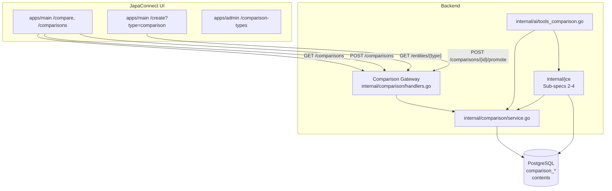

# Japa Comparison Engine (JCE) — Sub-spec 1: Foundation, Quick/Detailed Comparisons, and Cross-Domain Items

**Status:** Design — pending implementation plan
**Refs:** §14 (Content Type System), §23 (Main Site Frontend), §30 (Generic Comparison System), §39 (Space Types — University), §90 (Visa Route Comparison), §103 (AI Agent Executor), ADR-029, ADR-058, ADR-076, ADR-088, `docs/japa-comparison-engine.md`
**Scope:** First of four JCE sub-specs. Establishes the standalone `apps/main` surface, the quick (private by default) vs detailed (publishable) comparison split, the `/compare` item-selection tool (modeled on `/compare/universities`), the `/comparisons` public detailed-comparison directory, authenticated "My comparisons" tabs on both pages, quick-to-detailed promotion into `/create?type=comparison&draft={new_id}`, and a polymorphic `item_ref` so comparison types can contain each other (e.g. courses inside universities, universities inside countries). Out of scope for this sub-spec are JapaScore, eligibility scoring, user comparison profiles, data freshness/ingestion, and the AI decision agent — those are Sub-specs 2–4.

---

## 1. Problem

The current generic comparison system (§30) is a solid content-backed matrix, but it is not yet a product. The main issues:

1. **No quick-vs-detailed split.** `/compare/new` creates a draft and sends the user to the full composer. There is no lightweight "just the table" comparison for personal, private decision-making that can later be promoted into a public detailed comparison.
2. **No generic item-selection tool.** `/compare/universities` exists only for universities. There is no `/compare` page where a user picks any comparison type and selects 2+ real platform items to compare.
3. **No public detailed-comparison directory.** There is no `/comparisons` page that lists all published, editorial detailed comparisons.
4. **No cross-domain nesting.** A comparison type cannot contain another comparison type. Courses cannot be items inside a University comparison; Universities cannot be items inside a Country comparison; Cost-of-Living cannot be a row inside a City comparison.
5. **No promotion path.** A quick side-by-side comparison cannot be "promoted" into a rich, editorial detailed comparison with a body and SEO.
6. **Specialized comparison pages are silos.** `/compare/universities`, `/compare/mentors`, `/tools/visa-routes`, and `/tools/cost-of-living` exist but are not unified under a single comparison surface or engine.

The `docs/japa-comparison-engine.md` recommendation is to evolve the current generic system into a **Japa Comparison Engine (JCE)** — a decision platform with Smart Compare, JapaScore, personalization, data freshness, and an AI decision agent. This sub-spec lays the product foundation for that evolution.

---

## 2. Goal

Launch `apps/main` as the standalone comparison product surface and implement the core foundations that all later JCE capabilities will build on:

1. A new `apps/main` SvelteKit SSR app for the comparison experience.
2. Quick comparisons (`depth='quick'`) — lightweight, table-only, **private by default**, not indexed by search engines, created from the `/compare` item-selection tool. They can be deleted, edited, or promoted to a detailed comparison.
3. Detailed comparisons (`depth='detailed'`) — full content records with body, SEO, revisions, created via promotion or directly in `/create?type=comparison`. Their visibility is chosen by the author and can be public, unlisted, or private.
4. Quick-to-detailed promotion from `/compare/[slug]` to `/create?type=comparison&draft={new_id}` after the backend clones the quick comparison into a new detailed draft. The quick comparison remains private; the new detailed comparison is a separate content record whose visibility the author chooses at publish time.
5. A redesigned `/compare` item-selection page (public) where users pick a comparison type, search/filter/select 2+ items, and click **Compare** to generate a private quick comparison. Guests are redirected to login on submit.
6. A new `/comparisons` public directory (public) that lists published detailed comparisons with search, sort, filter, pagination, and page size.
7. Polymorphic `item_ref` on `comparison_items` so a comparison item can be a platform entity or another published comparison.
8. AI agent can create both quick and detailed comparisons.
9. `item_ref` resolver registry and generic entity search so existing tools (cost of living, remittance, scholarships, travel, visa routes, language tests, organizations, mentors, etc.) can feed entities into the comparison engine.
10. The surface is forward-compatible with Sub-specs 2–4 (JapaScore, profiles, scoring, data freshness, AI decision agent).

---

## 3. JCE master architecture

The JCE is built in four layers. Sub-spec 1 focuses on Layer 1 and the data hooks that Layer 2 will use.



### Sub-spec roadmap

| Sub-spec | Focus | Outcome |
|---|---|---|
| **1** (this doc) | Foundation, quick/detailed, nested items, `apps/main` | Shippable comparison product surface |
| **2** | User comparison profiles, weighted scoring profiles, Smart Compare mode | "Compare for me" personalization |
| **3** | JapaScore, eligibility engine, ranking, explainability, recommendations | Decision engine |
| **4** | JDIP data ingestion, data freshness, AI decision agent tools | Intelligence and AI advisor |

---

## 4. Sub-spec 1 scope and non-scope

### In scope

- New SvelteKit app `apps/main`.
- Schema additions: `comparison_content_metadata` and `comparison_items.item_ref`.
- Backend: quick-comparison CRUD, matrix read, promotion, type/item/dimension selection, generic entity search for the `/compare` picker, `item_ref` resolver registry.
- Frontend: `/compare` item-selection tool, `/compare/[slug]` quick preview, `/comparisons` directory, `/comparisons/[slug]` detail.
- AI: `comparison.create` tool supports `depth`.
- Admin: comparison type `config` JSONB for future type-specific picker and entity settings.
- Feature flags and permissions.
- Docker and routing assumptions for the new app.

### Out of scope

- `comparison_profiles` and user personalization (Sub-spec 2).
- `comparison_scores`, `comparison_score_factors`, eligibility rules, JapaScore (Sub-spec 3).
- `comparison_data_sources`, data ingestion, data freshness lifecycle (Sub-spec 4).
- Advanced AI tools (`comparison.analyze`, `comparison.rank`, `comparison.explain`) (Sub-spec 4).
- Full "Compare" button rollout on every tool page. Sub-spec 1 defines the resolver registry and `?preselect` contract; individual tool-page integrations are P0/P1 tasks within the Sub-spec 1 plan.

---

## 5. Domain model

| Term | Definition |
|---|---|
| **Comparison** | A `contents` row with `content_type = 'comparison'` plus child items, dimensions, and values. |
| **Quick comparison** | A comparison with `depth='quick'`: title, slug, items, dimensions, values, no rich body, **private by default**, not indexed. It is personal to the creator until promoted to detailed. |
| **Detailed comparison** | A comparison with `depth='detailed'`: quick data + body, body_html, SEO, revisions, published through the standard composer. |
| **Promotion** | Converting a quick private comparison into a new detailed content draft. The quick comparison remains private and unchanged; the detailed comparison is a separate content record whose visibility the author chooses. |
| **Comparison type** | An admin-defined schema (`comparison_type_definitions`) linked to a custom field group. Types are not just categories; they drive the item picker and default dimensions. |
| **Item ref** | A polymorphic reference on `comparison_items` that points to a platform entity (university, course, country, city, visa route, etc.) or another published comparison. |
| **Domain entity item** | A comparison item that resolves to a row in an entity table (e.g. `universities`, `courses`, `visa_routes`, `spaces`). |
| **Nested comparison item** | A comparison item that resolves to another published `contents` row of `content_type='comparison'`. |

---

## 6. Schema changes

### 6.1 `comparison_content_metadata`

New table. Keeps the generic `contents` table untouched while adding comparison-specific metadata.

```sql
CREATE TABLE comparison_content_metadata (
    content_id        uuid PRIMARY KEY REFERENCES contents(id) ON DELETE CASCADE,
    tenant_id         uuid NOT NULL REFERENCES tenants(id) ON DELETE CASCADE,
    depth             text NOT NULL CHECK (depth IN ('quick','detailed')) DEFAULT 'quick',
    promoted_from_id  uuid REFERENCES contents(id) ON DELETE SET NULL,
    promoted_at       timestamptz,
    smart_mode        text CHECK (smart_mode IN ('none','eligibility','cost','pathway','ai_advisor')) DEFAULT 'none',
    score_version     int NOT NULL DEFAULT 1,
    config            jsonb NOT NULL DEFAULT '{}',
    created_at        timestamptz NOT NULL DEFAULT now(),
    updated_at        timestamptz NOT NULL DEFAULT now()
);

CREATE INDEX idx_comparison_content_metadata_tenant_depth
    ON comparison_content_metadata(tenant_id, depth);

CREATE INDEX idx_comparison_content_metadata_promoted_from
    ON comparison_content_metadata(promoted_from_id)
    WHERE promoted_from_id IS NOT NULL;
```

- `depth` — `quick` for table-only comparisons, `detailed` for rich-body comparisons.
- `promoted_from_id` — when a detailed comparison was promoted from a quick one.
- `smart_mode` — reserved for Sub-spec 2/3 (e.g. `eligibility`, `cost`). `none` in this sub-spec.
- `config` — type-specific UI config (e.g. allowed item ref types, default page size). Reserved for future.

### 6.2 `comparison_items.item_ref`

Add a polymorphic reference column.

```sql
ALTER TABLE comparison_items
    ADD COLUMN item_ref jsonb NOT NULL DEFAULT '{}';

CREATE INDEX idx_comparison_items_item_ref
    ON comparison_items USING GIN(item_ref)
    WHERE item_ref <> '{}'::jsonb;
```

Valid `item_ref` shapes:

```json
{"type": "space", "id": "uuid", "title_cache": "..."}
{"type": "university", "id": "uuid", "title_cache": "..."}
{"type": "course", "id": "uuid", "title_cache": "..."}
{"type": "scholarship", "id": "uuid", "title_cache": "..."}
{"type": "visa_route", "id": "uuid", "title_cache": "..."}
{"type": "content", "id": "uuid", "content_type": "comparison", "title_cache": "..."}
{"type": "col_city", "id": "uuid", "title_cache": "..."}
```

- `title_cache` is a denormalized display title. It is updated when the source entity title changes or when the comparison is loaded.
- For Sub-spec 1, the resolver supports `university`, `course`, `space`, `content`, `visa_route`, and `col_city`. New types are added by registering a resolver in `internal/jce/entity` (future package) and a backend entity adapter.

### 6.3 `comparison_type_definitions.config`

Add a JSONB config column for type-specific settings.

```sql
ALTER TABLE comparison_type_definitions
    ADD COLUMN config jsonb NOT NULL DEFAULT '{}';
```

Example for a `universities` type:

```json
{
  "item_ref_types": ["university"],
  "default_item_count": 3,
  "max_item_count": 4,
  "allow_nested_comparisons": false
}
```

Example for a `countries` type:

```json
{
  "item_ref_types": ["space", "content"],
  "allowed_nested_types": ["universities", "cost_of_living"],
  "default_item_count": 3,
  "max_item_count": 5
}
```

### 6.4 `comparison_type_access` extension (optional)

No schema change needed. Access rules continue to use `can_create`, `can_fill`, `ai_can_fill`. We may later add `can_promote` as a permission check in the promotion handler.

---

## 7. Backend changes

### 7.1 Package structure

Keep `internal/comparison` as the generic CRUD/matrix engine. Add new behavior as thin extensions or new internal packages.

```
internal/
├── comparison/          # existing; CRUD, matrix, permissions
│   ├── comparison.go
│   ├── service.go
│   ├── handlers.go
│   └── store.go
├── jce/                 # new; product-specific orchestration
│   ├── service.go       # promotion, item ref resolution, type-driven creation
│   ├── handlers.go      # new /jce routes (or extend /comparisons)
│   ├── entity/          # item_ref resolvers per entity type
│   │   ├── resolver.go
│   │   ├── university.go
│   │   ├── course.go
│   │   ├── visa_route.go
│   │   ├── space.go
│   │   ├── content.go
│   │   └── col_city.go
│   └── promotion.go     # quick -> detailed promotion logic
```

Alternatively, for Sub-spec 1, keep the handlers inside `internal/comparison` and introduce `internal/jce` only when the intelligence layer begins in Sub-spec 3. Either is acceptable; the design is forward-compatible. The spec recommends starting with `internal/comparison` extensions and extracting `internal/jce` in Sub-spec 2/3.

### 7.2 Service changes

Extend `internal/comparison/service.go`:

- `CreateQuickComparison(ctx, tenantID, userID, CreateQuickComparisonInput)`
- `PromoteToDetailed(ctx, tenantID, userID, quickContentID)` — creates a new detailed `contents` row, clones items/dimensions/values, links via `promoted_from_id`, and returns the new content ID/slug.
- `ResolveItemRef(ctx, tenantID, itemRef)` — resolves a `item_ref` JSONB into a display title and canonical link.
- `SearchEntities(ctx, tenantID, entityType, SearchEntitiesInput)` — dispatches a search to the registered resolver for the given `item_ref.type` and returns candidate items for the `/compare` picker.
- `ListComparisonsWithFilters(ctx, tenantID, ListComparisonsInput)` — returns public detailed comparisons by default (`depth='detailed'`, `status='published'`, `visibility='public'`). With `mine=true`, returns the caller's own comparisons, filtered by `depth` and `status`.
- `CreateComparisonFromType(ctx, ...)` — creates a comparison with `item_ref` items and dimensions from the type's custom field group.

### 7.3 Handlers and routes

All routes are gated by `feature.comparison` and `feature.jce`. `feature.jce` is a new feature flag that enables the standalone app and new behavior.

```
GET    /api/v1/jce/comparisons              list public detailed comparisons (no `mine`) or owner's comparisons (`mine=true`)
       ?q={search}&sort={created_at|title|popularity}&filter_depth=quick|detailed|all
       &filter_type={slug}&filter_status=published|draft&mine=true|false&page={n}&page_size={n}
POST   /api/v1/jce/comparisons              create quick comparison (always private)
GET    /api/v1/jce/comparisons/{id|slug}    quick (owner/admin only) or detailed detail
GET    /api/v1/jce/comparisons/{id}/matrix  matrix (same visibility as detail)
POST   /api/v1/jce/comparisons/{id}/promote promote quick to detailed; returns new content id
GET    /api/v1/jce/comparison-types         list types available to current user
GET    /api/v1/jce/comparison-types/{slug}  type detail with field group/dimensions
POST   /api/v1/jce/comparisons/auto-items   suggest items from type + search (optional)
GET    /api/v1/jce/entities/{type}          list/search entities of a given type
       ?q=&limit=&offset=&space_id=...
```

The legacy `/api/v1/comparisons` route group is removed from `internal/server/server.go` in Sub-spec 1. The canonical `/jce/` routes are the only comparison endpoints; all consumers (`apps/main`, `apps/main` composer, and `apps/admin`) call `/api/v1/jce/*`.

### 7.4 Item ref resolution

Introduce an `ItemRefResolver` interface:

```go
type ItemRefResolver interface {
    EntityType() string
    Resolve(ctx context.Context, tenantID pgtype.UUID, id pgtype.UUID) (ResolvedItem, error)
    Search(ctx context.Context, tenantID pgtype.UUID, q string, filters map[string]any, limit, offset int) ([]ResolvedItem, error)
}

type ResolvedItem struct {
    ID          string
    Title       string
    Slug        string
    Description string
    ImageURL    string
    Link        string
    GeoSpaceID  *string
    Metadata    map[string]any
}
```

A registry maps `item_ref.type` to a resolver. Sub-spec 1 registers a core set and defines the pattern for adding more without schema changes.

**Core resolvers in Sub-spec 1:**
- `university` → `internal/university`
- `course` → `internal/learning`
- `space` → `internal/spaces`
- `visa_route` → `internal/visaroutes`
- `col_city` → `internal/costofliving`
- `scholarship` → `internal/scholarships`
- `remittance` → `internal/remittance`
- `languagetest` → `internal/languagetesthub`
- `organization` → `internal/organizations`
- `job` / `job_listing` → `internal/jobs`
- `travel` → `internal/travel`
- `mentor` → `internal/mentorship`
- `content` → `internal/content` (for nested comparisons and other content types)

The design aliases `col_country`, `remittance_provider`, `travel_route`, `hotel`, `flight` are reserved for future sub-specs where table-level filtering (e.g. `provider_type`, country-level cost-of-living rows) and additional resolvers are introduced. Sub-spec 1 registers the base names (`col_city`, `remittance`, `travel`) so the comparison type configs seeded by migration `000545` and `000546` resolve correctly.

Each resolver implements a `Search(ctx, tenantID, q, filters)` method so the generic `GET /api/v1/jce/entities/{type}` can be used by the `/compare` item picker.

If a resolver is missing, the item is still stored and displayed by `title_cache`. New tool resolvers can be registered without touching `comparison_items`.

### 7.5 Promotion flow

1. User views quick comparison at `/compare/[slug]` in `apps/main`. Quick comparisons are only accessible to the author or users with `comparison.edit_any`.
2. If the user is the author or has `comparison.edit_any`, show **"Promote to detailed comparison"**, **"Edit"**, and **"Delete"** actions.
3. Click calls `POST /api/v1/jce/comparisons/{id}/promote`.
4. Backend:
   - Verifies `depth='quick'` and ownership.
   - Creates a new `contents` row with `content_type='comparison'`, `status='draft'`, `depth='detailed'`.
   - Clones `comparison_items`, `comparison_dimensions`, and `comparison_values` to the new content.
   - Sets `comparison_content_metadata.promoted_from_id` to the quick content.
   - Returns new `{id, slug}`.
5. Frontend redirects to `apps/main` `/create?type=comparison&draft={new_id}`. The composer loads the draft and pre-fills title, items, dimensions, values, and body.

The detailed comparison can then be edited, body added, and published. Once public, it is available at `/comparisons/[slug]`.

### 7.6 Quick creation flow

On the `/compare` page:

1. User selects comparison type (from UI or via `?type={slug}` query param).
2. App fetches the type's `config` and the list of allowed `item_ref_types`.
3. The item picker pre-selects any items passed in `?preselect={item_ref_json}` (e.g. from a tool page **Compare** button).
4. User selects 2–`max_item_count` items from the type's item picker (public view).
5. **If guest:** clicking **Compare** redirects to login with selected item IDs preserved.
6. **If authenticated:** clicking **Compare** calls `POST /api/v1/jce/comparisons` with:
   - `depth='quick'`
   - `visibility='private'`
   - `seo_indexable=false`
   - `item_refs` from selected items
   - `title` auto-generated from item names
   - `dimensions` auto-generated from the type's custom field group
7. Backend creates `contents` row + metadata + items/dimensions/values.
8. Redirect to `/compare/[slug]` preview (private to author).

The user can edit dimensions and values on the quick preview page. Promotion is the path to a public detailed comparison.

---

## 8. Frontend changes

### 8.1 JCE routes in `apps/main`

The public comparison UI is part of the existing `apps/main` SvelteKit SSR app (port `3000` in development), using the same stack as the rest of the main app:

- `@sveltejs/adapter-node`
- `svelte` 5.x, `bits-ui`, `lucide-svelte`, `tailwindcss` 4.x
- `bun` as runtime and package manager

```
apps/main/
├── src/
│   ├── lib/
│   │   ├── api/                 # API client (mirror apps/main pattern)
│   │   ├── components/
│   │   │   ├── compare/
│   │   │   │   ├── CompareItemPicker.svelte
│   │   │   │   ├── CompareItemGrid.svelte
│   │   │   │   ├── CompareSelectedItems.svelte
│   │   │   │   ├── CompareTypeSelector.svelte
│   │   │   │   ├── MyQuickComparisons.svelte
│   │   │   │   └── QuickComparisonCard.svelte
│   │   │   ├── comparisons/
│   │   │   │   ├── ComparisonList.svelte
│   │   │   │   ├── ComparisonListFilters.svelte
│   │   │   │   ├── ComparisonPagination.svelte
│   │   │   │   ├── ComparisonCard.svelte
│   │   │   │   └── MyDetailedComparisons.svelte
│   │   │   ├── detail/
│   │   │   │   ├── ComparisonMatrix.svelte
│   │   │   │   ├── PromoteButton.svelte
│   │   │   │   ├── QuickActions.svelte
│   │   │   │   └── ShareActions.svelte
│   │   │   └── shared/
│   │   │       ├── TypeSelector.svelte
│   │   │       ├── ItemPicker.svelte
│   │   │       ├── DimensionEditor.svelte
│   │   │       └── ValueMatrix.svelte
│   │   ├── i18n/                # i18n setup, reuse apps/main keys where possible
│   │   ├── server/              # server-side API helpers
│   │   └── types/               # local TS types
│   ├── routes/
│   │   ├── (app)/
│   │   │   ├── compare/
│   │   │   │   ├── +page.svelte
│   │   │   │   ├── +page.server.ts
│   │   │   │   └── [slug]/
│   │   │   │       ├── +page.svelte
│   │   │   │       └── +page.server.ts
│   │   │   ├── comparisons/
│   │   │   │   ├── +page.svelte
│   │   │   │   ├── +page.server.ts
│   │   │   │   └── [slug]/
│   │   │   │       ├── +page.svelte
│   │   │   │       └── +page.server.ts
│   │   │   └── +layout.svelte
│   │   └── +layout.server.ts
│   ├── app.html
│   ├── app.d.ts
│   └── hooks.server.ts
├── package.json
├── svelte.config.js
├── tailwind.config.ts
├── tsconfig.json
└── vite.config.ts
```

### 8.2 `/compare` — item-selection tool (public)

The primary comparison creation surface. Guests can browse; only logged-in users can submit.

**Public default view:**
- **Comparison type selector** — dropdown or tabs of `comparison_type_definitions`. Defaults to `?type={slug}` if present.
- **Item list** — searchable, filterable list of entities matching the selected type's `item_ref_types`, fetched via `GET /api/v1/jce/entities/{type}`.
- **Multi-select** — user selects 2–`max_item_count` items. Pre-selects any items from `?preselect={item_ref_json}` (e.g. from a tool-page **Compare** button).
- **Compare button** —
  - **Logged-in:** calls `POST /api/v1/jce/comparisons` with `depth='quick'`, selected `item_refs`, and auto-generated title/dimensions, then redirects to `/compare/[slug]`.
  - **Guest:** redirect to `/login?redirect=/compare&selected_items=...` with selected items encoded in the query (or stored in a short-lived Valkey key). After login, the app restores the selection and creates the quick comparison.
- **No visibility selector** — quick comparisons are always private.
- **No explicit dimension editor** — dimensions are auto-generated from the type's custom field group, but the user can edit them on the quick preview page (`/compare/[slug]`).

**Authenticated "My comparisons" tab on `/compare`:**
- Shows the current user's **quick comparisons** only.
- Card grid with title, type chip, date, actions: Open, Edit, Delete, Promote.
- **New comparison** / **Compare more** button returns to the public item-selection view.

### 8.3 `/compare/[slug]` — quick comparison preview (private)

- SSR loads `GET /api/v1/jce/comparisons/{slug}` + `GET .../matrix`.
- Only returned for the author or `comparison.edit_any`. All others get 404.
- Renders matrix with items as columns, dimensions as rows.
- Resolves `item_ref` titles and links.
- Author can:
  - Edit title, dimensions, and cell values.
  - Delete the quick comparison.
  - **Promote to detailed comparison** — clones into a new detailed draft and redirects to `/create?type=comparison&draft={new_id}`.
- Quick comparisons are `seo_indexable=false` and cannot be shared publicly.

### 8.4 `/comparisons` — public detailed-comparison directory (public)

A separate public page for discovering published, editorial comparisons.

**Public default view:**
- SSR-fetches `GET /api/v1/jce/comparisons` (no `mine` param).
- Shows only `depth='detailed'` with `status='published'` and `visibility='public'`.
- Search, sort (`created_at`, `title`, `popularity`), type filter, pagination, page-size selector (12, 24, 48).
- Card grid with title, excerpt, type chip, author, date, view count, comment count.

**Authenticated "My comparisons" tab on `/comparisons`:**
- Shows the current user's **detailed comparisons** (draft and published, all visibilities).
- Cards show depth chip, status, visibility, and actions: Open, Edit, Delete.
- **Create detailed comparison** button links to `/create?type=comparison`.

### 8.5 `/comparisons/[slug]` — detailed comparison detail (public or auth)

- SSR loads `GET /api/v1/jce/comparisons/{slug}` + `GET .../matrix`.
- Public if `depth='detailed'`, `status='published'`, `visibility='public'`.
- Private detailed comparisons (`unlisted`/`private`) are only returned to the author or `comparison.edit_any`.
- Renders the full matrix and body.
- Author or `comparison.edit_any` sees **Edit** and **Delete**.

### 8.6 Promotion UX

- On `/compare/[slug]`, the **Promote** button opens a confirmation: "This will create a detailed comparison with a rich body and publish it through the composer."
- Calls `POST /api/v1/jce/comparisons/{id}/promote`.
- Backend clones the quick comparison into a new detailed draft.
- Redirects to `https://{main-domain}/create?type=comparison&draft={new_id}`.
- `apps/main` `/create` loads the draft and pre-fills the comparison builder with cloned items/dimensions/values.
- After the user adds a body and publishes, the detailed comparison is available at `/comparisons/[slug]`.

### 8.7 Shared components

`apps/main` does **not** import Svelte components from `apps/main` directly (separate app, separate build). Reuse is achieved by:
- Copying/adapting the existing `ComparisonMatrix.svelte` and `ComparisonBuilder.svelte` patterns.
- Or, if time allows, extracting a shared `packages/ui-comparison` package. This is out of scope for Sub-spec 1.

### 8.8 Tool integrations

Existing JapaConnect tools are integrated with the comparison engine through the `item_ref` resolver registry and lightweight "Compare" links.

**Integration patterns:**

1. **Resolver registration**
   - Every tool that wants its entities compared registers an `ItemRefResolver` in the JCE registry (see §7.4).
   - The resolver provides `Resolve(id)` and `Search(q, filters)`.

2. **Tool page "Compare" buttons**
   - Tool pages (e.g. cost-of-living city, visa route, scholarship detail, university detail, mentor profile, language test, remittance provider, organization, travel deal) can show a **"Compare"** or **"Add to comparison"** action.
   - Clicking it links to `/compare?type={comparison_type}&preselect={item_ref_json}`.
   - The `/compare` page reads `?type` and `?preselect`, sets the type, and pre-selects the item in the item picker.
   - The user can add more items and click **Compare** to create the quick comparison.

3. **Comparison-aware tool routes**
   - `/tools/visa-routes` can keep its current domain-specific comparison but can also expose **"Open in JCE"** to create a generic quick comparison.
   - `/tools/cost-of-living` can add a **"Compare cities"** link that pre-selects the current baseline city in `/compare?type=cost_of_living`.
   - `/compare/universities` and `/compare/mentors` can be replaced by `/compare?type=universities` and `/compare?type=mentors` once the resolver is ready, or keep a specialized first-run experience and redirect to the generic tool.

4. **Preselection persistence for guests**
   - Guests clicking **Compare** on a tool page are redirected to login with `?redirect=/compare?type=X&preselect=Y`.
   - After login the preselection is restored.

**Priority for Sub-spec 1:**

| Priority | Tool integration | Why |
|---|---|---|
| P0 | University (`/compare/universities`) | Existing comparison flow; must become generic. |
| P0 | Visa routes | High-traffic tool with clear entities. |
| P0 | Cost of living | Natural comparison domain (cities/countries). |
| P1 | Scholarships, remittance, language tests, organizations, jobs, travel, mentors | Add resolvers and "Compare" links. |

---

## 9. AI integration

Extend the existing `internal/ai/tools_comparison.go` `ComparisonCreateHandler` to support a `depth` argument.

```json
{
  "title": "...",
  "depth": "quick" | "detailed",
  "entity_type": "universities",
  "items": [{"name": "...", "slug": "...", "item_ref": {"type":"university","id":"..."}}],
  "dimensions": ["..."],
  "visibility": "private" | "public" | "unlisted"
}
```

- When `depth='quick'`, the engine creates a `contents` row with an empty body and `comparison_content_metadata.depth='quick'`. Unless an admin/AI explicitly overrides, the visibility defaults to `private` and `seo_indexable=false`.
- When `depth='detailed'`, it behaves as today: creates the content and leaves it as a draft for the user to publish with the requested visibility.
- The AI can also call `comparison.fill_values` to populate the matrix with provenance metadata, as it does today.

The higher-level JCE agent tools (`comparison.analyze`, `comparison.rank`, etc.) are out of scope for this sub-spec.

---

## 10. Admin changes

### 10.1 Comparison type config

The comparison type create/edit form gains a **Config** JSON field (textarea or a simple key/value editor) for:

- `item_ref_types`: list of allowed entity types.
- `default_item_count` and `max_item_count`.
- `allow_nested_comparisons`: boolean.
- `allowed_nested_types`: list of comparison type slugs that can be nested.

This is an advanced field; validation runs on save. A future enhancement can make it a form builder.

### 10.2 Comparison list

`apps/admin/src/routes/comparisons/+page.svelte` gains:
- Depth filter (quick/detailed).
- "Promoted from" column.
- Link to the `apps/main` detail view: quick → `/compare/{slug}`; detailed → `/comparisons/{slug}`.

No major admin changes beyond that are needed for Sub-spec 1.

---

## 11. API endpoints

| Method | Route | Purpose | Permission |
|---|---|---|---|
| `GET` | `/api/v1/jce/comparisons` | List public detailed comparisons (`/comparisons` page) | public (only published public detailed) |
| `GET` | `/api/v1/jce/comparisons?mine=true` | List current user's detailed comparisons (my tab on `/comparisons`) | authenticated |
| `GET` | `/api/v1/jce/comparisons?depth=quick&mine=true` | List current user's quick comparisons (my tab on `/compare`) | authenticated |
| `POST` | `/api/v1/jce/comparisons` | Create quick or detailed comparison (driven by `depth`) | `comparison.create` |
| `GET` | `/api/v1/jce/comparisons/{id\|slug}` | Detail | public for published public detailed; quick only for author or `comparison.edit_any`; private detailed only for owner/admin |
| `GET` | `/api/v1/jce/comparisons/{id\|slug}/matrix` | Matrix | same as detail |
| `POST` | `/api/v1/jce/comparisons/{id}/promote` | Promote quick to detailed | author or `comparison.edit_any` |
| `GET` | `/api/v1/jce/comparison-types` | List types for current user | authenticated (filtered by `can_create` for creation flows) |
| `GET` | `/api/v1/jce/comparison-types/{slug}` | Type detail | authenticated |
| `GET` | `/api/v1/jce/entities/{type}` | List/search entities of a given `item_ref` type for the `/compare` picker | public or auth depending on entity type |
| `GET` | `/api/v1/jce/entities/{type}/{id}` | Resolve a single entity for rendering an `item_ref` | public or auth depending on entity type |

The old `/api/v1/comparisons` path group is replaced by the new `/api/v1/jce/*` API. Existing `apps/main` comparison composer and wizards are migrated to call `/api/v1/jce/*` in Sub-spec 1; the old routes are removed from `internal/server/server.go`.

The JCE API also exposes the full comparison matrix CRUD needed by the `apps/main` composer (and the `apps/main` quick preview): `POST /api/v1/jce/comparisons/{id}/items`, `PATCH /api/v1/jce/comparisons/items/{item_id}`, `POST /api/v1/jce/comparisons/{id}/items/reorder`, `POST /api/v1/jce/comparisons/{id}/dimensions`, `PATCH/DELETE /api/v1/jce/comparisons/dimensions/{dimension_id}`, `PUT /api/v1/jce/comparisons/dimensions/{dimension_id}/values`, plus `GET /api/v1/jce/comparisons/dimension-types` and `POST /api/v1/jce/comparisons/auto-dimensions`. Comparison type definition CRUD moves to `/api/v1/jce/comparison-types`.

---

## 12. Permissions and feature flags

### 12.1 Permissions

Existing permission nodes are reused:
- `comparison.create`
- `comparison.edit_own`
- `comparison.edit_any`
- `comparison.delete_own`
- `comparison.delete_any`
- `comparison.type.create`
- `comparison.type.edit`
- `comparison.type.delete`

No new permission nodes for Sub-spec 1. Promotion uses `comparison.edit_own` or `comparison.edit_any`.

### 12.2 Feature flags

| Flag | Default | Purpose |
|---|---|---|
| `feature.comparison` | `true` | Master comparison feature flag. |
| `feature.jce` | `false` | Enables the `apps/main` app and the new `/jce/` API routes. When off, `/compare` and `/comparisons` stay in `apps/main` as-is. |
| `feature.jce.nested_items` | `false` | Enables the item ref picker and nested comparison features. Can ship after Sub-spec 1 core. |
| `feature.jce.ai_quick` | `false` | Enables AI creation of quick comparisons. Can ship after core. |

---

## 13. Routing and deployment

### 13.1 App routing

`apps/main` serves `/compare` and `/comparisons` directly in its existing SSR surface (port `3000` in development). In production, the reverse proxy routes those paths to the same `apps/main` service as the rest of the main domain.

```nginx
location / {
    proxy_pass http://main:3000;
}
```

### 13.2 `apps/main` interaction

- `apps/main` hosts the `/compare` picker, `/comparisons` directory, and `/compare/[slug]` quick comparison detail.
- `apps/main` continues to host `/create?type=comparison` and the detailed composer (`CreateShell`/`ComparisonBuilder`).
- When `feature.jce` is on, `/compare` and `/comparisons` render the JCE public UI.
- Promotion from a quick comparison to a detailed comparison navigates to `/create?type=comparison&draft={new_id}` inside `apps/main`.

---

## 14. Phased delivery within Sub-spec 1

| Phase | Deliverable | Approximate complexity |
|---|---|---|
| **1.1** | `apps/main` scaffold, package setup, dev server, layout | Small |
| **1.2** | Schema: `comparison_content_metadata`, `comparison_items.item_ref`, `comparison_type_definitions.config` | Small |
| **1.3** | Backend: quick comparison CRUD, matrix, detail, list with basic pagination | Medium |
| **1.4** | Frontend: `/compare` item-selection page with type selector, item search, multi-select, guest login redirect | Medium-Large |
| **1.5** | Frontend: `/compare/[slug]` quick preview with edit/delete/promote | Medium |
| **1.6** | Frontend: `/comparisons` public directory with search/sort/filter/pagination and my tab | Medium |
| **1.7** | Backend + frontend: promotion to detailed (`/create?type=comparison&draft={new_id}`) | Medium |
| **1.8** | Backend: `item_ref` resolver registry and resolvers for university, course, space, visa_route, content, col_city, scholarship, remittance, languagetest, organization, job, travel, mentor | Medium |
| **1.9** | Frontend: nested item picker, cross-domain comparison creation, `?preselect` query support | Medium |
| **1.10** | Tool-page "Compare" buttons and links on P0 tools (university, visa routes, cost of living) and P1 tools as bandwidth allows | Medium |
| **1.11** | AI: `depth` support in `comparison.create` tool | Small |
| **1.12** | Admin: type config UI, depth filter in comparison list | Small |
| **1.13** | E2E tests, integration tests, QA | Medium |

Phases 1.1–1.7 deliver the quick/detailed foundation. Phases 1.8–1.9 deliver cross-domain nesting and the resolver registry. Phase 1.10 integrates existing tool pages. Phase 1.11 adds AI. Phase 1.12 polishes admin.

---

## 15. Testing strategy

### 15.1 Unit tests

- `internal/comparison/service_test.go`: quick creation, promotion, `item_ref` resolution, list filtering.
- `internal/comparison/handlers_test.go`: new JCE routes, permission checks, promotion.

### 15.2 Integration tests

- Database migration tests for `comparison_content_metadata` and `item_ref`.
- End-to-end `POST /jce/comparisons` → `GET /jce/comparisons/{slug}` → `POST /jce/comparisons/{id}/promote` flow.

### 15.3 Frontend tests

- `apps/main` route tests for `/compare` item selection and `/comparisons` directory rendering.
- Component tests for `CompareTypeSelector`, `CompareItemPicker`, `ComparisonList`, `ValueMatrix`.

### 15.4 E2E

- Guest selects items on `/compare` → login redirect → quick comparison created → view at `/compare/[slug]`.
- Create quick comparison from `/compare` → view at `/compare/[slug]` → promote to detailed → publish → view at `/comparisons/[slug]`.
- Cross-domain: create a `countries` comparison, add a `universities` comparison as an item.

---

## 16. Risks and mitigation

| Risk | Mitigation |
|---|---|
| Routing `/compare` and `/comparisons` inside `apps/main` | Rendered as standard `(app)` group routes; they share the same AppShell, auth, and feature gating as the rest of the main app. |
| `item_ref` polymorphism becomes unwieldy | Resolver registry with per-entity adapters. Unknown types fall back to `title_cache`. |
| Duplicating `ComparisonMatrix`/`ComparisonBuilder` in `apps/main` | Accept duplication for Sub-spec 1; plan a shared package for Sub-spec 2 or 3. |
| `apps/main` `/create` composer does not load cloned draft with matrix items | `apps/main` `+page.server.ts` already fetches `comparisonDetail` for a `?draft=` id when `content_type='comparison'`; clone must set `depth='detailed'` and include the same items/dimensions/values so the existing restore path works. |
| Old `/comparisons` public API and new `/jce/comparisons` diverge | Legacy routes removed in Sub-spec 1; all consumers migrate to `/api/v1/jce/*`. |
| Guest selection lost across login redirect | Store selected item IDs in query param or a short-lived Valkey key (e.g. `jc:compare:selection:{token}`) tied to the `redirect` URL. |
| Feature flag rollout | `feature.jce` default `false`; enable per-tenant after QA. |

---

## 17. Future sub-specs (summary)

### Sub-spec 2 — Personalization & Smart Compare

- `comparison_profiles` table and UI.
- "My Japa Profile" assessment.
- Smart Compare mode: user selects profile, gets ranked results.
- Scoring profile presets: Student, Skilled Worker, Family.

### Sub-spec 3 — JapaScore & Decision Engine

- New `internal/jce` package: `scoring.go`, `ranking.go`, `eligibility.go`, `explainability.go`, `recommendations.go`.
- `comparison_scores` and `comparison_score_factors` tables.
- Eligibility Compare, Cost Compare, Ranking with explainable factors.
- Next-best action recommendations.

### Sub-spec 4 — Data Intelligence & AI Decision Agent

- `comparison_data_sources` table and data freshness lifecycle.
- Data ingestion jobs (visa fees, tuition, cost of living, exchange rates).
- AI agent tools: `comparison.analyze`, `comparison.rank`, `comparison.score`, `comparison.explain`, `comparison.recommend_next_step`.
- AI Advisor Compare: natural language to structured comparison.

---

## 18. Open questions

1. Should the promotion UX open `apps/main` `/create?type=comparison&draft={new_id}` or a new composer inside `apps/main`?
2. Should `apps/main` `/compare` and `/comparisons` render immediately when `feature.jce` is on, or coexist behind a soft-launch banner?
3. Which entity types get resolvers in Phase 1.7? Are `scholarship`, `job`, and `remittance_provider` tables ready?
4. Should the quick comparison matrix allow editing after creation (yes, by author until promoted), and should edits sync back to the promoted detailed comparison (no, promotion is a copy at the time of promotion)?
5. Should quick comparisons have expiring/auto-deletion (e.g. delete after 30 days of inactivity) or are they retained until the user deletes them?
6. Should the `/comparisons` "My comparisons" tab also show quick comparisons that the user has already promoted, or only the detailed records?
7. Which tool pages get the first **Compare** button integration? (University, visa routes, and cost of living are proposed P0.)
8. Should tool-specific comparison pages such as `/tools/visa-routes` and `/tools/cost-of-living` be fully migrated into the generic JCE, or kept as specialized views with an **"Open in JCE"** link?

